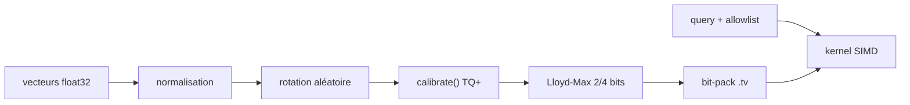

# RyanCodrai/turbovec

> Quantized Rust vector index with Python bindings, no prior training phase.

## The problem
A corpus of 10M documents weighs 31 GB in float32, and classic PQ indexes
require a separate `train()` before you can ingest.

## What it actually does
Implements TurboQuant (Google Research, ICLR 2026): normalization, random
orthogonal rotation, optional per-coordinate calibration (TQ+), Lloyd-Max
scalar quantization to 2 or 4 bits, bit-packing, then length-based rescoring
to de-bias the dot product. Online ingest with no training. Hand-written SIMD
kernels (NEON SDOT/SMMLA, AVX-512 VNNI, `vpermb`, falling back to AVX2 then scalar).
`sync(path)` persists only the delta, one fsync per call. Filtering by id
allowlist is applied inside the kernel, in blocks of 32 vectors.

## How it is wired


## Trying it
```bash
pip install turbovec
python3 benchmarks/download_data.py openai-1536
python3 benchmarks/suite/recall_d1536_2bit.py
cargo run --release --example insert_bench -- --dim 1536 --bits 2
```

## Cost and gotchas
Free, fully local, nothing leaves the machine. `vectors` and `query` must be
2-D float32 arrays: other dtypes are rejected, not converted. The benefit of
filtering depends on how selective the allowlist is.

## What it is not
Not a vector database: no server, no metadata, no SQL queries — an in-memory
index with file persistence. The announced gains over FAISS are measured by
the author on two specific GCP machines; on GloVe d=200, TurboQuant falls
behind FAISS at 2 bits beyond k≈8. No license is declared in the README.

## Alternatives
- FAISS `IndexPQFastScan`: the production reference compared here.
- `turboquant-py`: another community implementation of TurboQuant.

## For you
The serious candidate for a local RAG where RAM is the constraint — to be tested after
checking the license.
