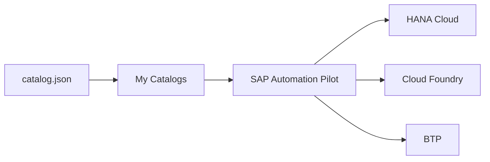

# SAP-samples/automation-pilot-examples

> Command examples for SAP Automation Pilot, which automates the operation of HANA Cloud, Cloud Foundry and BTP.

## The problem
SAP teams repeat manual operations (backups, restarts, secret rotation) across their BTP landscape.

## What it actually does
Each example is a `catalog.json` file to import into Automation Pilot, bundling commands: HANA Cloud lifecycle, bulk stop and start, certificate expiry checks, HTTP requests through Cloud Connector, Python or Node.js scripts. One example uses generative AI for the status of Cloud Foundry applications.

## How it is wired

## Trying it
No command documented: copy an example's `catalog.json` and import it into the My Catalogs section of Automation Pilot with the Import button.

## Cost and gotchas
Access to SAP Automation Pilot is required, with a BTP trial account possible. The SAP service is a SaaS, and the examples are provided as is, to be tested outside production.

## What it is not
Not a standalone tool: without the SAP service, the files are useless. They are not official automations covered by SAP support.

## Alternatives
No alternative named in the README.

## For you
Ignore: reserved for teams that operate SAP BTP, unrelated to data, AI or MLOps work outside SAP.
