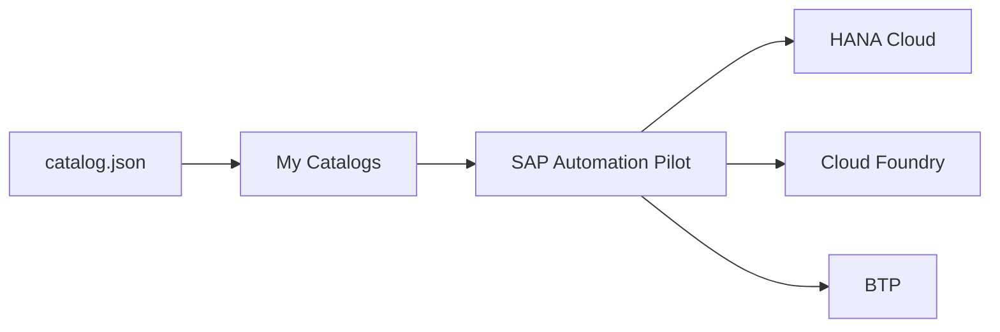

# SAP-samples/automation-pilot-examples

> Exemples de commandes pour SAP Automation Pilot, qui automatise l'exploitation de HANA Cloud, Cloud Foundry et BTP.

## Le problème
Les équipes SAP répètent des opérations manuelles (sauvegardes, redémarrages, rotation de secrets) sur leur paysage BTP.

## Ce que ça fait vraiment
Chaque exemple est un fichier `catalog.json` à importer dans l'Automation Pilot, regroupant des commandes : cycle de vie HANA Cloud, arrêt et démarrage en masse, contrôle d'expiration de certificats, requêtes HTTP via Cloud Connector, scripts Python ou Node.js. Un exemple utilise l'IA générative pour l'état des applications Cloud Foundry.

## Comment c'est branché

## Essayer
Aucune commande documentée : copier le `catalog.json` d'un exemple, l'importer dans la section My Catalogs de l'Automation Pilot via le bouton Import.

## Coût et pièges
Il faut un accès à SAP Automation Pilot, avec un compte d'essai BTP possible. Le service SAP est un SaaS, et les exemples sont fournis tels quels, à tester hors production.

## Ce que ce n'est pas
Pas un outil autonome : sans le service SAP, les fichiers ne servent à rien. Ce ne sont pas des automations officielles couvertes par le support SAP.

## Alternatives
Aucune alternative nommée dans le README.

## Pour toi
À ignorer : réservé aux équipes qui exploitent SAP BTP, sans lien avec un travail data, IA ou MLOps hors SAP.

