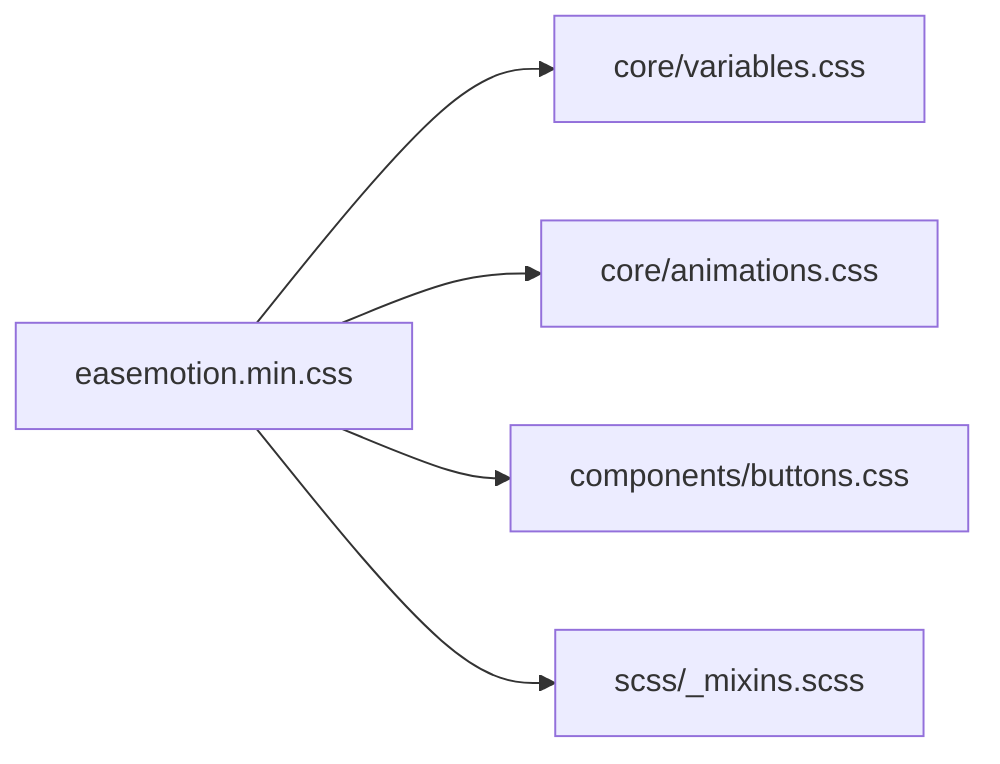

# SAPTARSHI-coder/EaseMotion-css

> Dependency-free CSS framework focused on animations, with readable class names.

## The problem
Adding clean animations to an interface requires writing CSS or configuring a build tool.

## What it actually does
A stylesheet to link via CDN or install through npm (`easemotion-css`), with classes `ease-fade-in`, `ease-slide-up`, `ease-hover-grow`, buttons and cards, CSS variables, a SCSS layer (mixins) and a React `Animate` component provided as an example. The README claims 28.2 kB gzipped.

## How it is wired
Simplified diagram based on the sheet, no diagram provided.


## Trying it
```bash
npm install easemotion-css
```

## Cost and gotchas
Free. 538 open issues and up to 100 PRs per day per contributor announced: a repository geared toward mass contribution (GSSoC program), quality to be verified.

## What it is not
Not a demonstrated competitor to Tailwind: the README's comparison comes from the author.

## Alternatives
- Tailwind CSS: cited by the README, with a build step and short classes.

## For you
Ignore: front-end CSS unrelated to data or AI, of uncertain maturity.
