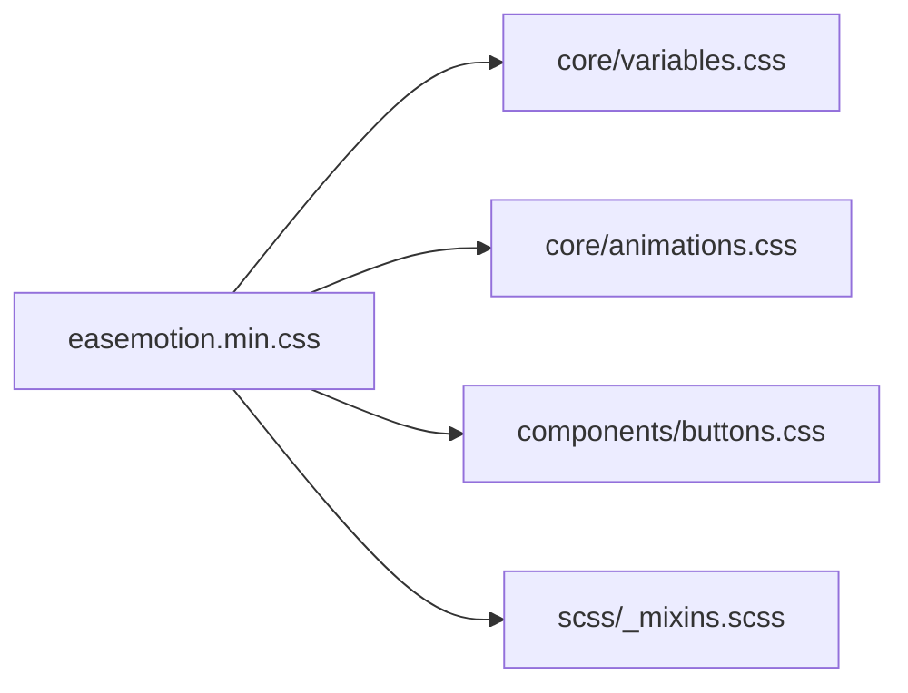

# SAPTARSHI-coder/EaseMotion-css

> Framework CSS sans dépendance centré sur les animations, avec des noms de classes lisibles.

## Le problème
Ajouter des animations propres à une interface demande d'écrire du CSS ou de configurer un outil à build.

## Ce que ça fait vraiment
Feuille de style à lier par CDN ou installer par npm (`easemotion-css`), avec des classes `ease-fade-in`, `ease-slide-up`, `ease-hover-grow`, des boutons et cartes, des variables CSS, une couche SCSS (mixins) et un composant React `Animate` fourni en exemple. Le README annonce 28,2 ko gzippés.

## Comment c'est branché
Schéma simplifié d'après la fiche, sans diagramme fourni.


## Essayer
```bash
npm install easemotion-css
```

## Coût et pièges
Gratuit. 538 issues ouvertes et jusqu'à 100 PR par jour par contributeur annoncés : dépôt orienté contribution de masse (programme GSSoC), qualité à vérifier.

## Ce que ce n'est pas
Pas un concurrent démontré de Tailwind : la comparaison du README vient de l'auteur.

## Alternatives
- Tailwind CSS : cité par le README, avec build et classes courtes.

## Pour toi
À ignorer : CSS front-end sans rapport avec la data ou l'IA, de maturité incertaine.

