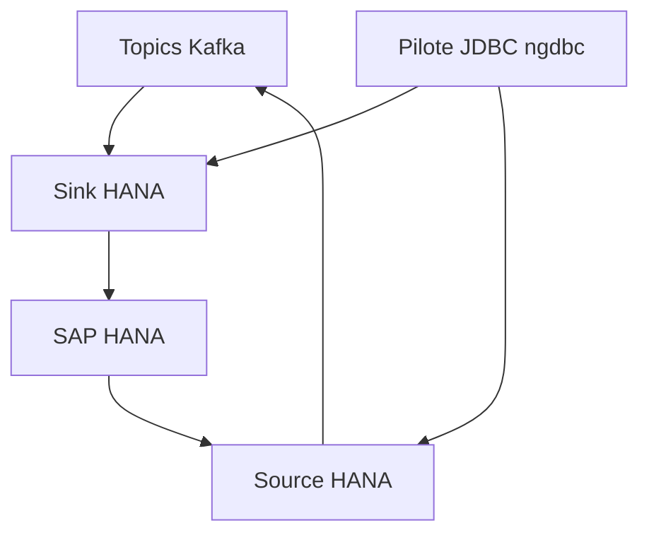

# SAP/kafka-connect-sap

> Kafka Connect source and sink connectors to read from and write to SAP HANA.

## The problem
Connecting Kafka to SAP HANA without writing a custom integration.

## What it actually does
A sink writes topics into HANA tables (schema creation and evolution, insert or upsert, deletion by tombstone, partitioning). A source reads in bulk or incremental mode, by table or SQL query. An `EscapeFieldNameCharacters` transformation adapts field names. Only SAP HANA is supported.

## How it is wired
Simplified diagram based on the sheet, no diagram provided.



## Trying it
```bash
mvn clean install -DskipTests
```

## Cost and gotchas
Free, but it requires SAP HANA, Kafka Connect, Maven and the JDBC driver (SAP developer license). Repository archived, last push in March 2025.

## What it is not
Not a generic SAP connector: HANA only. Not maintained, since it is archived.

## Alternatives
None cited in the README.

## For you
Ignore: archived and tied to SAP HANA; only worth a look for an existing setup already in place.
