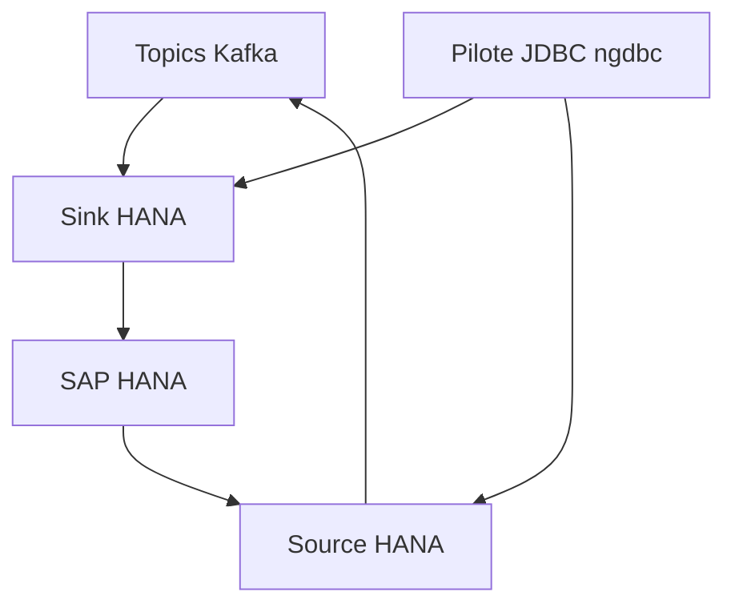

# SAP/kafka-connect-sap

> Connecteurs Kafka Connect source et sink pour lire et écrire dans SAP HANA.

## Le problème
Brancher Kafka sur SAP HANA sans écrire d'intégration sur mesure.

## Ce que ça fait vraiment
Un sink écrit les topics dans des tables HANA (création et évolution de schéma, insert ou upsert, suppression par tombstone, partitionnement). Une source lit en mode bulk ou incrémental, par table ou requête SQL. Une transformation `EscapeFieldNameCharacters` adapte les noms de champs. Seul SAP HANA est pris en charge.

## Comment c'est branché
Schéma simplifié d'après la fiche, sans diagramme fourni.



## Essayer
```bash
mvn clean install -DskipTests
```

## Coût et pièges
Gratuit, mais il faut SAP HANA, Kafka Connect, Maven et le pilote JDBC (licence développeur SAP). Dépôt archivé, dernier push en mars 2025.

## Ce que ce n'est pas
Pas un connecteur SAP générique : HANA uniquement. Pas maintenu, puisque archivé.

## Alternatives
Aucune citée dans le README.

## Pour toi
Ignorer : archivé et lié à SAP HANA ; à ne regarder que pour un existant déjà en place.

