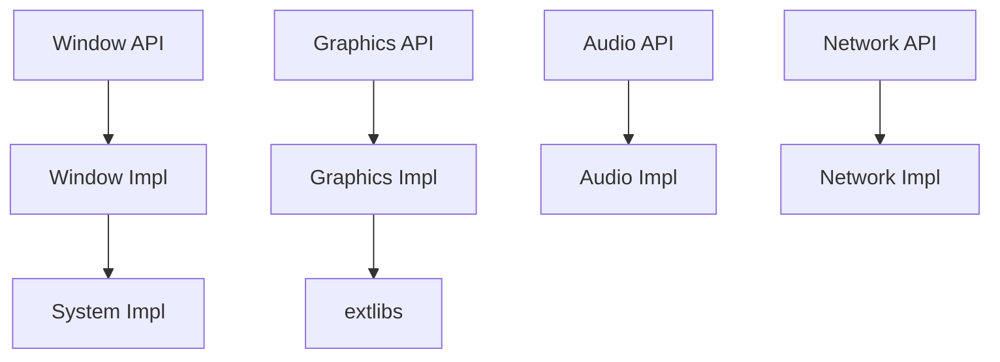

# SFML/SFML

> Cross-platform C++ multimedia library for windows, graphics, audio, and networking, mainly for games and 2D applications.

## The problem
Writing a portable graphical or audio application means handling each system API directly.

## What it actually does
Five modules: System, Window, Graphics, Audio, Network, with an object-oriented C++ API. Active development targets version 3 on `master`; the 2.x series no longer receives features. Bindings exist for C, .Net, Ruby, and Python. External libraries (stb_image, freetype, miniaudio, libogg...) are provided in `extlibs`.

## How it is wired

## Trying it
No command in the README. It points to per-platform tutorials and a CMake project template that downloads and builds SFML with your application.

## Cost and gotchas
C++ compilation with CMake. The licenses of the external libraries vary (some GPL or permissive at your choice), to be checked if you redistribute.

## What it is not
Not a game engine: no scene management or physics. Not a data or AI tool.

## Alternatives
No alternative named in the README.

## For you
Ignore: excellent for 2D games in C++, but unrelated to data, AI, or MLOps work.
