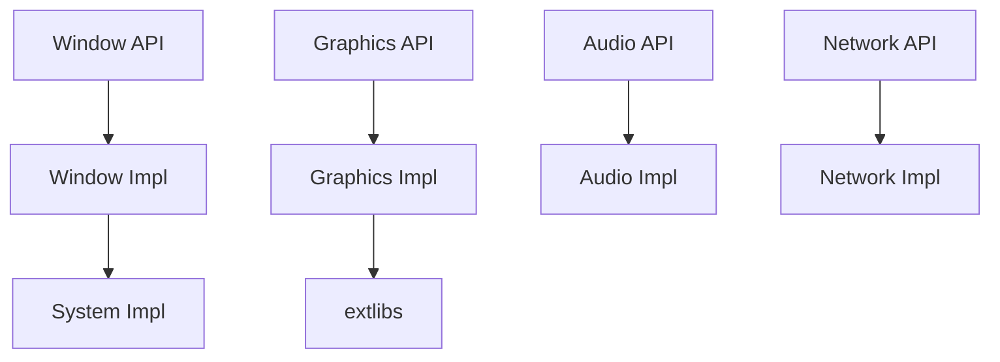

# SFML/SFML

> Bibliothèque C++ multimédia multiplateforme pour fenêtres, graphismes, audio et réseau, surtout pour jeux et applications 2D.

## Le problème
Écrire une application graphique ou audio portable oblige à manier directement chaque API système.

## Ce que ça fait vraiment
Cinq modules : System, Window, Graphics, Audio, Network, avec une API orientée objet en C++. Le développement actif cible la version 3 sur `master` ; la série 2.x ne reçoit plus de fonctionnalités. Des liaisons existent pour C, .Net, Ruby et Python. Les bibliothèques externes (stb_image, freetype, miniaudio, libogg…) sont fournies dans `extlibs`.

## Comment c'est branché

## Essayer
Aucune commande dans le README. Il renvoie aux tutoriels par plateforme et à un modèle de projet CMake qui télécharge et construit SFML avec ton application.

## Coût et pièges
Compilation C++ avec CMake. Les licences des bibliothèques externes varient (certaines au choix GPL ou permissives), à vérifier si tu redistribues.

## Ce que ce n'est pas
Pas un moteur de jeu : aucune gestion de scène ou de physique. Pas un outil data ou IA.

## Alternatives
Aucune alternative nommée dans le README.

## Pour toi
À ignorer : excellent pour le jeu 2D en C++, mais sans lien avec un travail data, IA ou MLOps.

