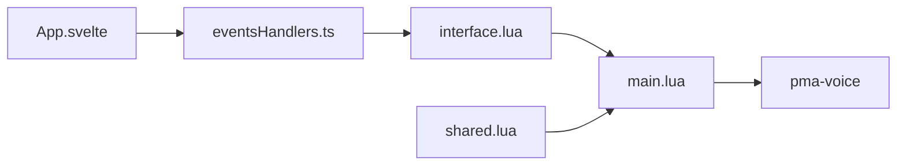

# SOH69/mm_radio

> Radio script with a Svelte interface for FiveM role-play servers.

## The problem
RP servers want a modern in-game radio, with restricted channels, battery and jammers.

## What it actually does
FiveM resource: Svelte NUI interface, channels limited by job or gang, submix effect, battery, notifications, name overlay, placeable jammers. Depends on ox_lib, pma-voice, bl_bridge and OneSync. Two exports: `JoinRadio`, `LeaveRadio`.

## How it is wired


## Trying it
```bash
git clone https://github.com/SOH69/mm_radio.git
cd mm_radio/web
pnpm i
pnpm run build
```

## Cost and gotchas
GPL-3.0: copyleft. The README points to a Tebex shop. Last push in August 2024.

## What it is not
Not a generic communication tool.

## Alternatives
No alternative named in the README.

## For you
Ignore: FiveM game mod, unrelated to data/AI/MLOps.
