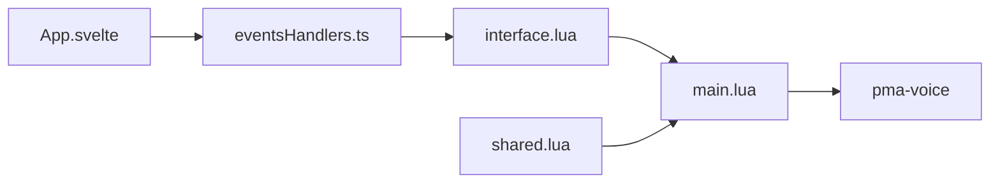

# SOH69/mm_radio

> Script de radio avec interface Svelte pour serveurs FiveM de jeu de rôle.

## Le problème
Les serveurs RP veulent une radio de jeu moderne, avec canaux restreints, batterie et brouilleurs.

## Ce que ça fait vraiment
Ressource FiveM : interface NUI en Svelte, canaux limités par job ou gang, effet de submix, batterie, notifications, overlay des noms, brouilleurs posables. Dépend d'ox_lib, pma-voice, bl_bridge et OneSync. Deux exports : `JoinRadio`, `LeaveRadio`.

## Comment c'est branché


## Essayer
```bash
git clone https://github.com/SOH69/mm_radio.git
cd mm_radio/web
pnpm i
pnpm run build
```

## Coût et pièges
GPL-3.0 : copyleft. Le README renvoie à une boutique Tebex. Dernier push en août 2024.

## Ce que ce n'est pas
Pas un outil de communication générique.

## Alternatives
Aucune alternative nommée dans le README.

## Pour toi
À ignorer : mod de jeu FiveM, sans rapport avec data/IA/MLOps.

