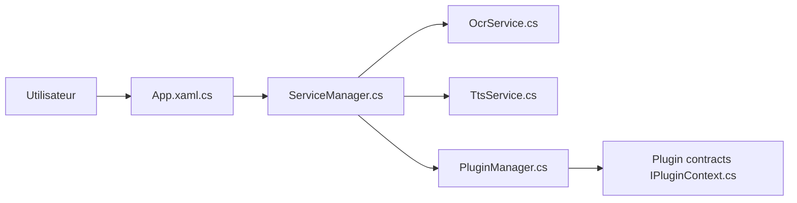

# STranslate/STranslate

> Windows translation and OCR application with pluggable providers.

## The problem
Translating or reading on-screen text means switching tools for each translation or OCR engine.

## What it actually does
The README describes almost nothing: installation by release archive, online documentation, author zggsong. Based on the code architecture, a desktop application with translation, OCR, text-to-speech and vocabulary services, loaded as plugins through a manager.

## How it is wired

## Trying it
No command documented: download the latest release and extract it.

## Cost and gotchas
Free under the MIT license; translation or OCR providers may require their own keys (not documented).

## What it is not
Not cross-platform based on the architecture (Windows application). Minimal sheet: the README is too short.

## Alternatives
- No alternative named in the README.

## For you
Ignore: Windows desktop utility, unrelated to data/AI; insufficient material to go further.
