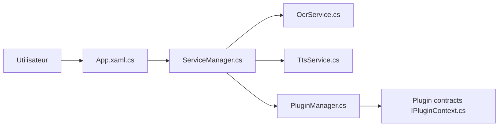

# STranslate/STranslate

> Application Windows de traduction et d'OCR à fournisseurs enfichables.

## Le problème
Traduire ou lire du texte à l'écran demande de changer d'outil pour chaque moteur de traduction ou d'OCR.

## Ce que ça fait vraiment
Le README ne décrit presque rien : installation par archive de release, documentation en ligne, auteur zggsong. D'après l'architecture du code, application de bureau avec services de traduction, OCR, synthèse vocale et vocabulaire, chargés comme plugins via un gestionnaire.

## Comment c'est branché

## Essayer
Aucune commande documentée : télécharger la dernière release et l'extraire.

## Coût et pièges
Gratuit selon la licence MIT ; les fournisseurs de traduction ou d'OCR peuvent exiger leurs propres clés (non documenté).

## Ce que ce n'est pas
Pas multiplateforme d'après l'architecture (application Windows). Fiche minimale : le README est trop court.

## Alternatives
- Aucune alternative nommée dans le README.

## Pour toi
À ignorer : utilitaire de bureau Windows, sans rapport avec la data/IA ; matière insuffisante pour aller plus loin.

