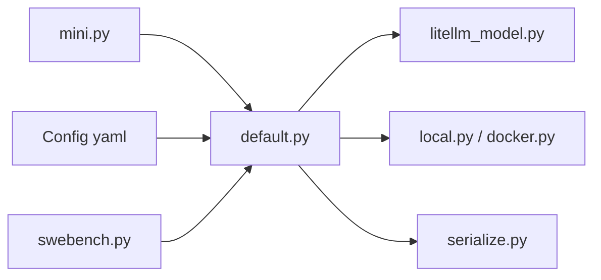

# SWE-agent/mini-swe-agent

> Minimal coding agent (bash only, linear history), for research and everyday use.

## The problem
Coding agents are black boxes with custom tooling, hard to audit, sandbox and fine-tune.

## What it actually does
About a hundred lines for the agent class: the LM proposes a bash command, executed via `subprocess.run`, and the observation is appended to the history.
All models through litellm, OpenRouter, Portkey and Requesty, with no tool-calling required.
Local, Docker, Singularity, bubblewrap and SWE-ReX environments.
Batch SWE-bench benchmark runs and a trajectory inspector.

## How it is wired


## Trying it
```bash
pip install uv && uvx mini-swe-agent
pip install mini-swe-agent
mini
```

## Cost and gotchas
LLM provider key at your expense. Without a sandbox, commands run locally.

## What it is not
Not an IDE nor an agent with rich tooling: to experiment with tools or history processors, the authors recommend SWE-agent.

## Alternatives
- SWE-agent: when you want specific tools and interfaces.

## For you
Adopt it as a basis for agent experimentation and evaluation: the code can be read in full, the trajectory feeds directly into fine-tuning, and it reaches over 74% on SWE-bench Verified.
