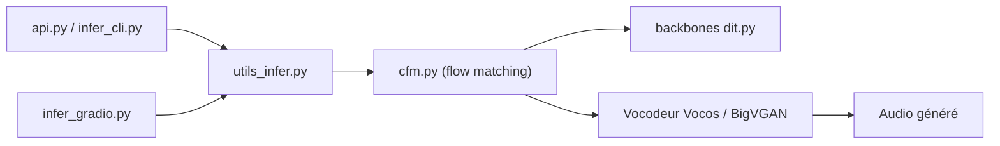

# SWivid/F5-TTS

> Flow-matching speech synthesis model that clones a voice from a short reference audio.

## The problem
Producing a natural voice from text, in the timbre of a given speaker, without training one model per voice or building a homemade TTS pipeline.

## What it actually does
The code generates speech conditioned on a reference audio and its transcription (or an automatic transcription if `--ref_text` is empty). `cfm.py` carries the flow matching, with DiT, MMDiT or UNet-T backbones; a vocoder (Vocos, BigVGAN optional) converts to audio. The repository also ships training/finetuning (Accelerate), evaluation and a Triton + TensorRT-LLM serving setup (RTF 0.0394 measured by the authors on an L20 GPU).

## How it is wired


## Trying it
```bash
conda create -n f5-tts python=3.11
conda activate f5-tts
pip install f5-tts
f5-tts_infer-gradio
f5-tts_infer-cli --model F5TTS_v1_Base \
--ref_audio "provide_prompt_wav_path_here.wav" \
--ref_text "The content, subtitle or transcription of reference audio." \
--gen_text "Some text you want TTS model generate for you."
```

## Cost and gotchas
PyTorch must match your hardware (CUDA, ROCm, XPU, Apple Silicon); FFmpeg required. Checkpoints are downloaded from Hugging Face. Leaving `--ref_text` empty launches an ASR: extra GPU memory.

## What it is not
It is not a hosted service or a ready-to-use API. The license of the weights is not documented in the README (only the code is MIT in the catalog). Nothing about governing the use of voice cloning.

## Alternatives
The README does not cite any other competing repository; it itself includes E2 TTS, a faithful reproduction of the paper, in the same project.

## For you
Adopt: zero-shot TTS installable via pip, with CLI, Gradio and a GPU serving path, MIT code; just check the weights license before any product use.
