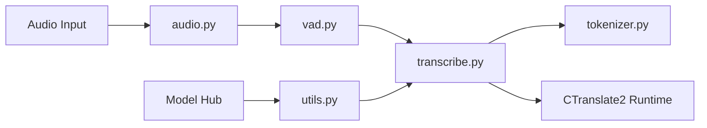

# SYSTRAN/faster-whisper

> Reimplementation of Whisper on CTranslate2 to transcribe audio faster and with less memory.

## The problem
openai/whisper is slow and VRAM-hungry; transcribing large volumes of audio costs a lot of GPU time.

## What it actually does
`WhisperModel` loads a CTranslate2-converted model (downloaded from the Hub) and returns timestamped segments through a generator.
int8 quantization on CPU/GPU, `BatchedInferencePipeline` for batching, word-level timestamps.
Built-in Silero VAD filter; audio decoding via PyAV (no system FFmpeg).
Conversion script for any Transformers-compatible Whisper, including fine-tuned models.

## How it is wired


## Trying it
```bash
pip install faster-whisper
ct2-transformers-converter --model openai/whisper-large-v3 --output_dir whisper-large-v3-ct2 --copy_files tokenizer.json preprocessor_config.json --quantization float16
```

## Cost and gotchas
Free. GPU: cuBLAS + cuDNN 9 for CUDA 12; for CUDA 11, downgrade ctranslate2. `segments` is lazy: transcription only starts when you iterate.

## What it is not
Not a diarization service nor a hosted API. Benchmarks depend on beam size (5 here, 1 in openai/whisper).

## Alternatives
- openai/whisper: the original implementation, simpler but slower.
- whisper.cpp: lighter on CPU.
- whisper-standalone-win (Purfview): ready-made binaries for Windows.

## For you
Adopt: the default transcription building block for a Python audio → text pipeline, MIT-licensed and easy to quantize.
