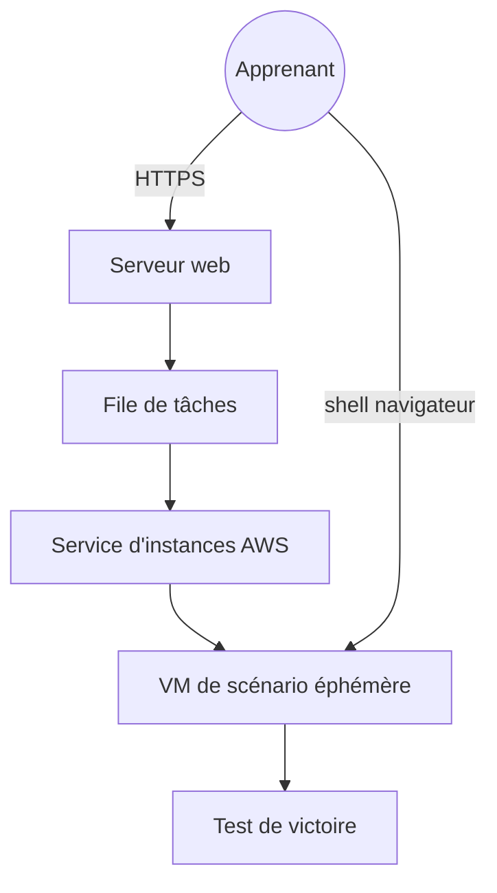

# SadServers/sadservers

> Online platform to practice Linux and DevOps troubleshooting on real servers, capture-the-flag style.

## The problem
Server diagnosis skills (Linux, Docker, Kubernetes) are hard to test without a machine that is really broken and a verifiable win condition.

## What it actually does
The user picks a scenario, an ephemeral server is launched on AWS and they get a shell in the browser. A test validates the fix. The README describes the service: Django, Celery and RabbitMQ, SQLite, an Nginx proxy driven by Consul, Gotty and a Go agent on each VM. This repository mostly contains the scenario catalog, not the service code. It is also used to assess candidates and models.

## How it is wired

## Trying it
No command documented to run the repository: the service is used from sadservers.com after creating an account.

## Cost and gotchas
Account required. Command history is reserved for Pro+ or Business accounts. No license in the repository: reuse of the scenarios is not allowed by default. Replay feature discontinued in December 2025.

## What it is not
It is not a tool to self-host: the SaaS implementation is not in the tree shown. Nor is it a course, but hands-on challenges.

## Alternatives
No alternative named in the README, apart from Katacoda (closed in May 2022).

## For you
Watch: a good troubleshooting practice ground for an MLOps profile, but a service hosted by a single person and without a license, to be used as a client, not as a building block.
