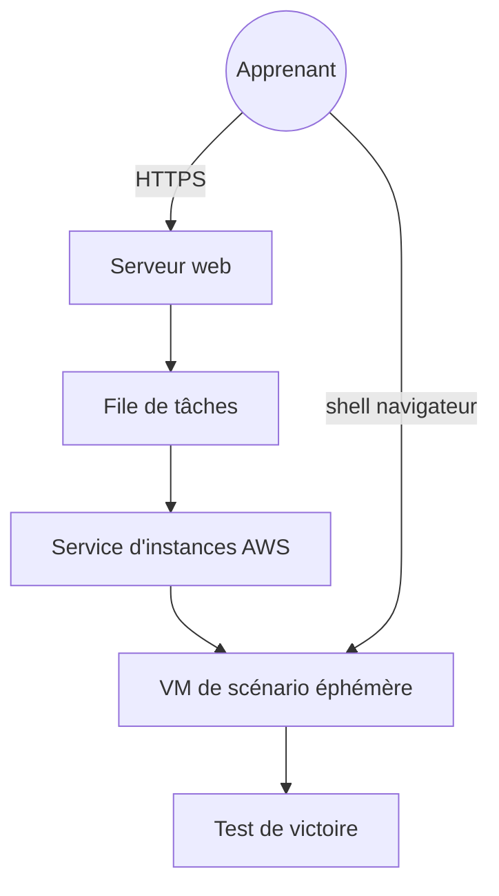

# SadServers/sadservers

> Plateforme en ligne pour s'entraîner au dépannage Linux et DevOps sur de vrais serveurs, façon capture du drapeau.

## Le problème
Les compétences de diagnostic serveur (Linux, Docker, Kubernetes) sont difficiles à tester sans machine réellement cassée ni condition de victoire vérifiable.

## Ce que ça fait vraiment
L'utilisateur choisit un scénario, un serveur éphémère est lancé sur AWS et il obtient un shell dans le navigateur. Un test valide la correction. Le README décrit le service : Django, Celery et RabbitMQ, SQLite, proxy Nginx piloté par Consul, Gotty et un agent Go sur chaque VM. Ce dépôt contient surtout le catalogue des scénarios, pas le code du service. Elle sert aussi à évaluer des candidats et des modèles.

## Comment c'est branché

## Essayer
Aucune commande documentée pour exécuter le dépôt : le service s'utilise depuis sadservers.com après création d'un compte.

## Coût et pièges
Compte à créer. L'historique des commandes est réservé aux comptes Pro+ ou Business. Licence absente du dépôt : réutilisation des scénarios non autorisée par défaut. Fonction de rejeu arrêtée en décembre 2025.

## Ce que ce n'est pas
Ce n'est pas un outil à auto-héberger : l'implémentation du SaaS n'est pas dans l'arborescence montrée. Ce n'est pas non plus un cours, mais des épreuves pratiques.

## Alternatives
Aucune alternative nommée dans le README, hors Katacoda (fermé en mai 2022).

## Pour toi
À surveiller : un bon terrain d'entraînement au dépannage pour un profil MLOps, mais service hébergé par une seule personne et sans licence, à utiliser comme client, pas comme brique.

