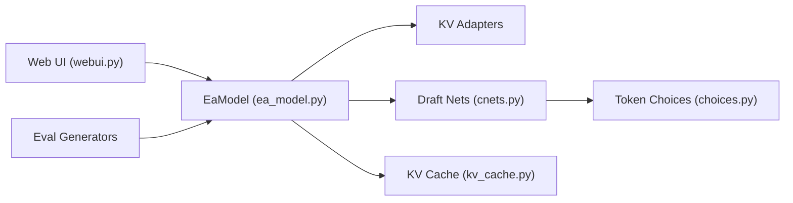

# SafeAILab/EAGLE

> Speculative decoding that speeds up LLM generation without changing the distribution of the generated text.

## The problem
Token-by-token generation is slow; models of 13 to 70 billion parameters occupy the GPU for a long time.

## What it actually does
A small "draft" model proposes several tokens as a tree, which the base model verifies; `eagenerate` replaces Hugging Face's `generate`. EAGLE-3 fuses features from several layers. The README claims up to 5.6x on Vicuna 13B (2 RTX 3090, fp16). Official weights for Vicuna, LLaMA 2/3, Mixtral, Qwen2, DeepSeek-R1-Distill; training via DeepSpeed.

## How it is wired


## Trying it
```bash
git clone https://github.com/SafeAILab/EAGLE.git
cd EAGLE
python -m venv ~/venvs/ea_env
source ~/venvs/ea_env/bin/activate
pip install -r requirements.txt
python -m eagle.evaluation.gen_ea_answer_llama3chat --ea-model-path yuhuili/EAGLE3-LLaMA3.1-Instruct-8B --base-model-path meta-llama/Llama-3.1-8B-Instruct --use_eagle3
```

## Cost and gotchas
GPU essential. The EAGLE weights must match the base model; unofficial checkpoints vary. Gated models (Llama): Hugging Face token. The speedup factors are those announced by the authors.

## What it is not
Not an inference server: for production, the README recommends SpecForge (training with SGLang) and the vLLM integration.

## Alternatives
- Medusa, Lookahead: compared in the README.
- SpecForge: recommended for training EAGLE-3.

## For you
Adopt it if you serve LLMs on GPU: published method (ICML, EMNLP, NeurIPS), adopted in vLLM and SGLang, measurable latency gain on your own models.
