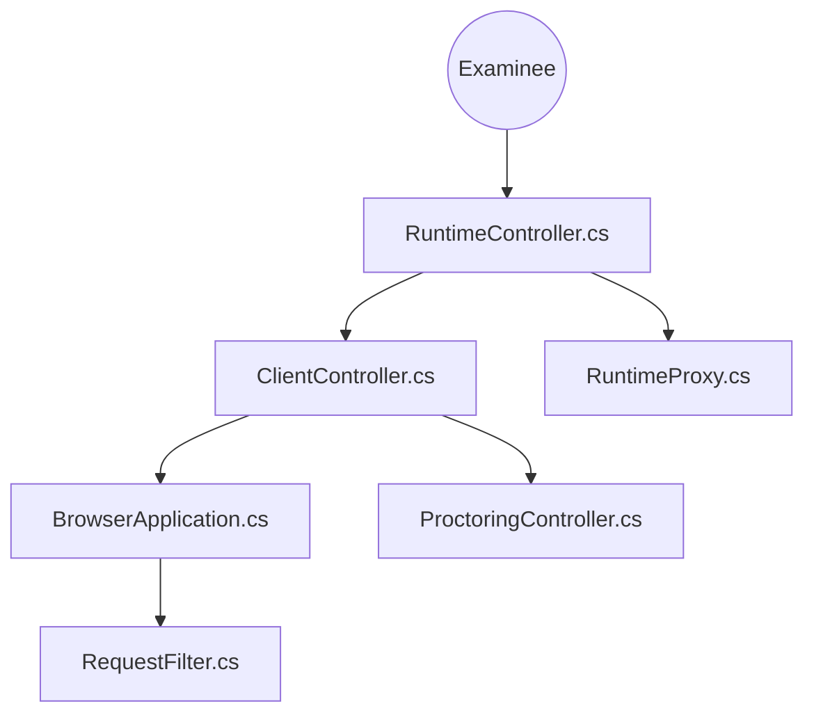

# SafeExamBrowser/seb-win-refactoring

> Locked-down Windows browser based on Chromium for taking supervised online exams.

## The problem
During an online exam, the student can open other applications or websites; their workstation has to be restricted.

## What it actually does
SEB starts a session, sets up the exam environment, and opens a restricted Chromium browser with request filtering and, depending on the configuration, monitoring or proctoring enabled. A service communicates with the client for session events. The README does not detail the features.

## How it is wired
Diagram based on the code diagram.

## Trying it
No documented commands. The README points to the published releases.

## Cost and gotchas
Free. Windows 10 version 1803 minimum, .NET Framework 4.8 and the Visual C++ Redistributable. The builds linked in the README are tests: use the latest official release.

## What it is not
It is not an exam platform: you need an exam server or a compatible site. This repo is the Windows version only.

## Alternatives
No alternative named in the README.

## For you
Ignore: an education tool for Windows, unrelated to data or AI work.
