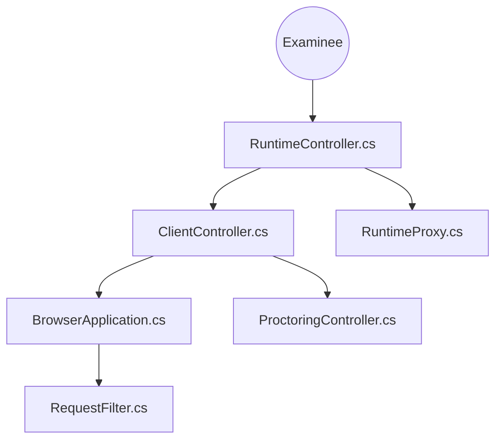

# SafeExamBrowser/seb-win-refactoring

> Navigateur Windows verrouillé basé sur Chromium pour faire passer des examens en ligne sous contrôle.

## Le problème
Pendant un examen en ligne, l'étudiant peut ouvrir d'autres applications ou sites ; il faut restreindre son poste.

## Ce que ça fait vraiment
SEB démarre une session, configure l'environnement d'examen, ouvre un navigateur Chromium restreint avec filtrage des requêtes et, selon la configuration, activation de la surveillance ou du proctoring. Un service communique avec le client pour les événements de session. Le README ne détaille pas les fonctions.

## Comment c'est branché
Schéma d'après le diagramme du code.

## Essayer
Aucune commande documentée. Le README renvoie vers les versions publiées.

## Coût et pièges
Gratuit. Windows 10 version 1803 minimum, .NET Framework 4.8 et Visual C++ Redistributable. Les builds du README sont des tests : utiliser la dernière version officielle.

## Ce que ce n'est pas
Ce n'est pas une plateforme d'examen : il faut un serveur d'examen ou un site compatible. Ce dépôt est la version Windows uniquement.

## Alternatives
Aucune alternative nommée dans le README.

## Pour toi
À ignorer : outil d'éducation pour Windows, sans lien avec un travail data ou IA.

