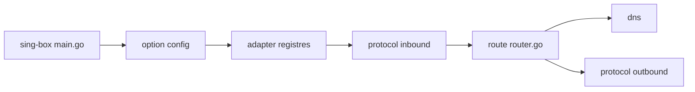

# SagerNet/sing-box

> Universal proxy platform: routing, DNS and many outbound protocols, driven by configuration.

## The problem
Passing network traffic through several proxy protocols with unified routing and DNS rules.

## What it actually does
The README is only two lines long; what follows comes from the architecture as seen in the code. An executable (`cmd/sing-box`) reads a typed configuration (`option/`), instantiates inbounds, outbounds, DNS and services (`adapter/`), then the routing engine (`route/`) picks the outbound according to rules (domain, IP, process, protocol). The documentation is hosted separately.

## How it is wired

## Trying it
No command documented in the README (it points to https://sing-box.sagernet.org).

## Cost and gotchas
Free. A license is present but not identified by GitHub: read it before any use. 340 open issues.

## What it is not
It is not a turnkey tool: without a detailed configuration it does nothing. Not enough material here to judge how easy it is to get started.

## Alternatives
No alternative named in the README.

## For you
Ignore for data/AI/MLOps work: it is network infrastructure with no direct link, and the license needs checking.
