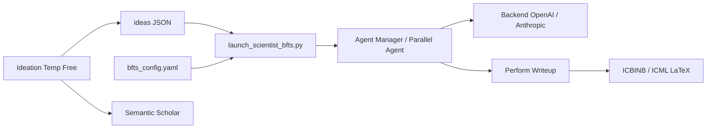

# SakanaAI/AI-Scientist-v2

> Agentic pipeline that generates ideas, ML experiments and a LaTeX paper, for researchers curious about automation.

## The problem
Exploring an ML research idea requires ideation, experiment code, analysis and writing: weeks of human work.

## What it actually does
An ideation script (`perform_ideation_temp_free.py`) produces JSON ideas from a Markdown topic, with a novelty check via Semantic Scholar.
`launch_scientist_bfts.py` launches a best-first tree search (config `bfts_config.yaml`) where parallel agents write and run code.
The results feed plotting, LLM/VLM review and writing modules based on LaTeX templates (ICBINB, ICML).
The README warns: lower success rate than v1, and the code written by the LLM is executed.

## How it is wired


## Trying it
```bash
conda create -n ai_scientist python=3.11
conda activate ai_scientist
pip install -r requirements.txt
python ai_scientist/perform_ideation_temp_free.py --workshop-file "ai_scientist/ideas/my_research_topic.md" --model gpt-4o-2024-05-13 --max-num-generations 20 --num-reflections 5
python launch_scientist_bfts.py --load_ideas "ai_scientist/ideas/my_research_topic.json" --load_code --add_dataset_ref --model_writeup o1-preview-2024-09-12 --model_citation gpt-4o-2024-11-20 --model_review gpt-4o-2024-11-20 --model_agg_plots o3-mini-2025-01-31 --num_cite_rounds 20
```

## Cost and gotchas
Linux + NVIDIA/CUDA GPU; roughly $15-20 per experiment run plus ~$5 for writing according to the README, several hours.
Runs LLM-generated code: run it in a sandbox (Docker).

## What it is not
Not a reliable paper generator: many runs do not end in a PDF.
Not better than v1 when a good template exists. License not identified by GitHub.

## Alternatives
- AI Scientist-v1: preferable for clear objectives with a solid template (higher success rate).

## For you
Worth watching: an interesting demonstrator of an agentic ML experimentation loop, but costly, risky to run and with an unclear license for real use.
