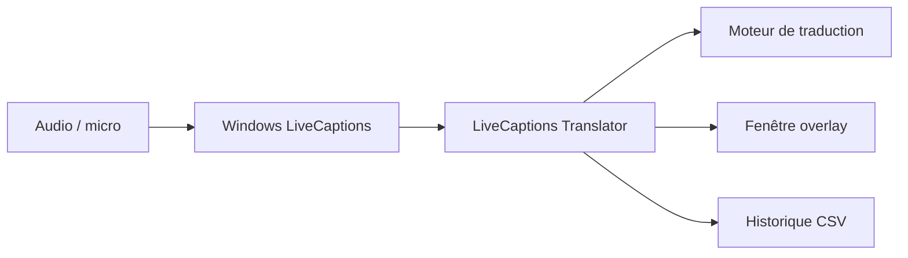

# SakiRinn/LiveCaptions-Translator

> Real-time speech translation on top of Windows 11 Live Captions.

## The problem
Translating a meeting or video live requires Copilot+ hardware or a heavy toolchain.

## What it actually does
Launches Windows Live Captions, reads their text and sends it to a translation engine: Ollama, OpenAI-compatible API, OpenRouter, Google Translate, DeepL, Youdao, Baidu, MTranServer or LibreTranslate. Shows an adjustable overlay window, a history exportable to CSV and log cards. The author recommends LLM engines for incomplete sentences.

## How it is wired

## Trying it
No command documented. Download from Releases, configure Live Captions (position "Overlaid on screen"), then launch the tool.

## Cost and gotchas
Windows 11 22H2 minimum. .NET 8 or a version with the runtime. Online engines: API key or quota billed to you, and the transcribed text is sent to them. You must change the source language in Live Captions. The README ends with an empty "Activity" section.

## What it is not
Not a speech recognition engine: it depends on Windows. Not available outside Windows.

## Alternatives
No alternative named in the README.

## For you
Worth watching: plugs a local LLM (Ollama) into a transcription stream, but limited to Windows 11.
