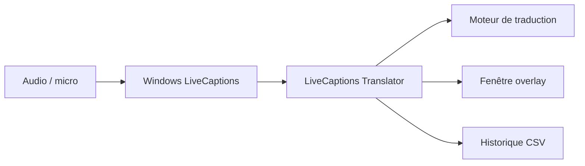

# SakiRinn/LiveCaptions-Translator

> Traduction de parole en temps réel au-dessus des sous-titres en direct de Windows 11.

## Le problème
Traduire en direct une réunion ou une vidéo demande un matériel Copilot+ ou une chaîne d'outils lourde.

## Ce que ça fait vraiment
Lance les Live Captions de Windows, lit leur texte et l'envoie à un moteur de traduction : Ollama, API compatible OpenAI, OpenRouter, Google Translate, DeepL, Youdao, Baidu, MTranServer ou LibreTranslate. Affiche une fenêtre de superposition réglable, un historique exportable en CSV et des cartes de journal. L'auteur recommande les moteurs LLM pour les phrases incomplètes.

## Comment c'est branché

## Essayer
Aucune commande documentée. Télécharger depuis Releases, configurer Live Captions (position « Overlaid on screen »), puis lancer l'outil.

## Coût et pièges
Windows 11 22H2 minimum. .NET 8 ou version avec runtime. Moteurs en ligne : clé d'API ou quota à ta charge, et le texte transcrit leur est envoyé. Il faut changer la langue source dans Live Captions. README terminé par une section « Activity » vide.

## Ce que ce n'est pas
Pas un moteur de reconnaissance vocale : il dépend de Windows. Pas disponible hors Windows.

## Alternatives
Aucune alternative nommée dans le README.

## Pour toi
À surveiller : branche un LLM local (Ollama) sur un flux de transcription, mais limité à Windows 11.

