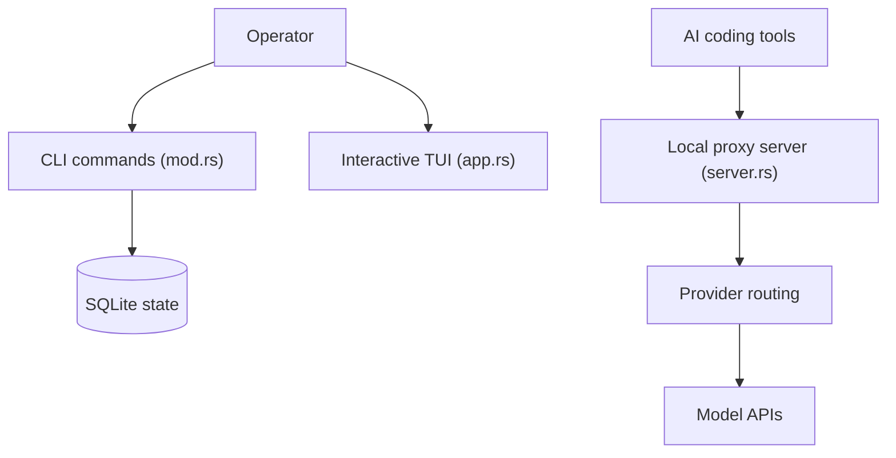

# SaladDay/cc-switch-cli

> TUI and CLI interface to manage providers, MCP, prompts and skills of several coding agents.

## The problem
Each agent (Claude Code, Codex, Gemini, OpenCode, Hermes, OpenClaw, Pi) has its own configuration files to edit in order to change provider.

## What it actually does
A Rust binary switches provider in one gesture, manages MCP servers, system prompts and skills for seven agents, with backups and WebDAV synchronization. A local proxy, managed by a daemon on macOS and Linux, routes requests to the model APIs with failover. It imports sessions to count tokens and costs. State lives in a SQLite database under `~/.cc-switch`.

## How it is wired


## Trying it
```bash
curl -fsSL https://github.com/SaladDay/cc-switch-cli/releases/latest/download/install.sh | bash
cc-switch
cc-switch provider list
cc-switch proxy show
```

## Cost and gotchas
Free, but provider keys remain at your expense. The `ANTHROPIC_API_KEY` or `OPENAI_API_KEY` environment variables can override the configuration. The managed proxy does not exist on Windows.

## What it is not
Not a model provider nor a hosted gateway: a local switcher. It is a command-line fork of CC-Switch, not the original application.

## Alternatives
- CC-Switch (original graphical version): desktop interface, compatible WebDAV synchronization.

## For you
Watch: useful if you juggle several agents and providers, but it handles your keys and configs, so test it on a copy.
