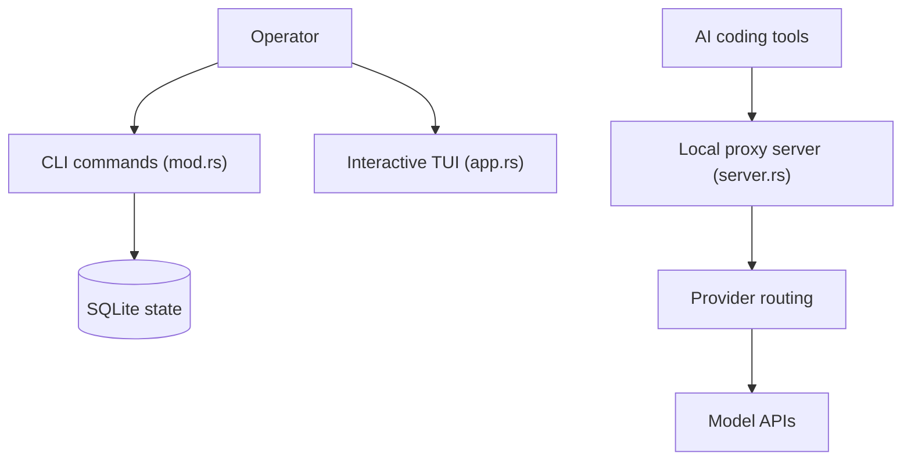

# SaladDay/cc-switch-cli

> Interface TUI et CLI pour gérer fournisseurs, MCP, prompts et skills de plusieurs agents de code.

## Le problème
Chaque agent (Claude Code, Codex, Gemini, OpenCode, Hermes, OpenClaw, Pi) a ses propres fichiers de configuration à éditer pour changer de fournisseur.

## Ce que ça fait vraiment
Un binaire Rust change de fournisseur d'un geste, gère serveurs MCP, prompts système et skills pour sept agents, avec sauvegardes et synchronisation WebDAV. Un proxy local, géré par un démon sur macOS et Linux, route les requêtes vers les API de modèles avec reprise sur panne. Il importe les sessions pour compter jetons et coûts. L'état vit dans une base SQLite sous `~/.cc-switch`.

## Comment c'est branché


## Essayer
```bash
curl -fsSL https://github.com/SaladDay/cc-switch-cli/releases/latest/download/install.sh | bash
cc-switch
cc-switch provider list
cc-switch proxy show
```

## Coût et pièges
Gratuit, mais les clés des fournisseurs restent à ta charge. Les variables d'environnement `ANTHROPIC_API_KEY` ou `OPENAI_API_KEY` peuvent écraser la configuration. Le proxy géré n'existe pas sous Windows.

## Ce que ce n'est pas
Ce n'est pas un fournisseur de modèles ni une passerelle hébergée : un commutateur local. C'est un fork en ligne de commande de CC-Switch, non l'application d'origine.

## Alternatives
- CC-Switch (version graphique d'origine) : interface de bureau, synchronisation WebDAV compatible.

## Pour toi
À surveiller : utile si tu jongles entre plusieurs agents et fournisseurs, mais il manipule tes clés et configs, donc à tester sur une copie.

