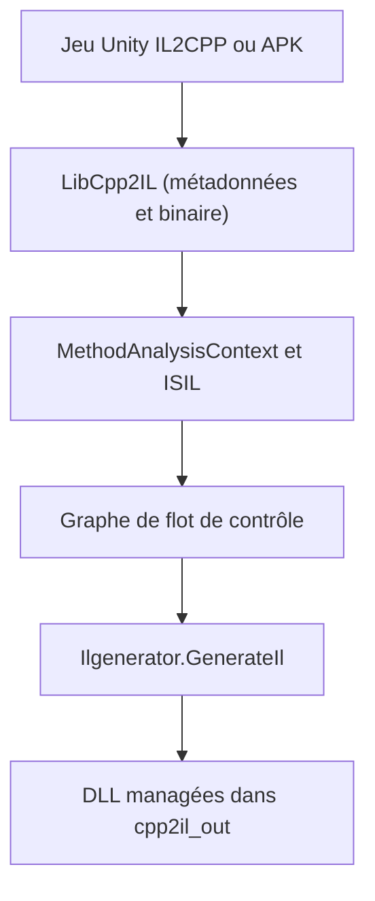

# SamboyCoding/Cpp2IL

> Rebuilds .NET assemblies from Unity games compiled with IL2CPP, for modding and analysis.

## The problem
A Unity game compiled with IL2CPP loses its managed assemblies; modding or analysis becomes nearly impossible without reconstruction.

## What it actually does
Reads the native binary and its metadata, detects the Unity version, then produces managed DLLs, metadata dumps or method dumps. Decompilation goes through an intermediate representation, ISIL, and a control-flow graph, then generates CIL. The development branch is a rewrite: options have been replaced by output formats and processing layers. APK support.

## How it is wired
Simplified diagram based on the sheet, no diagram provided.


## Trying it
```bash
Cpp2IL-Win.exe --game-path=C:\Path\To\Your\Game
```
The `--list-output-formats` and `--list-processors` options list the available formats and layers.

## Cost and gotchas
Free. The decompiled CIL remains "quite messy" according to the author; ILSpy is recommended. Every commit is a CI build, milestone versions are published by hand. The branch being rewritten offers fewer features than earlier versions.

## What it is not
Not an intrusion or protection-bypass tool. Not a faithful C# decompiler: the resulting code is approximate.

## Alternatives
No alternative cited; Il2CppInterop and MelonLoader are related projects that build on it.

## For you
Ignore: Unity game reverse engineering, outside the data / AI / MLOps scope.
