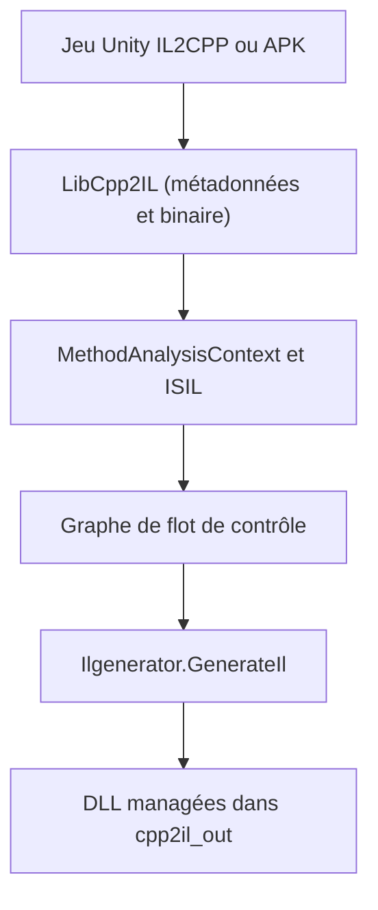

# SamboyCoding/Cpp2IL

> Reconstruit des assemblages .NET à partir de jeux Unity compilés en IL2CPP, pour le modding et l'analyse.

## Le problème
Un jeu Unity compilé en IL2CPP perd ses assemblages managés ; le modding ou l'analyse devient presque impossible sans reconstruction.

## Ce que ça fait vraiment
Lit le binaire natif et ses métadonnées, repère la version d'Unity, puis produit des DLL managées, des dumps de métadonnées ou de méthodes. La décompilation passe par une représentation intermédiaire ISIL et un graphe de flot de contrôle, puis génère du CIL. La branche de développement est une réécriture : les options ont été remplacées par des formats de sortie et des couches de traitement. Prise en charge d'APK.

## Comment c'est branché
Schéma simplifié d'après la fiche, sans diagramme fourni.


## Essayer
```bash
Cpp2IL-Win.exe --game-path=C:\Path\To\Your\Game
```
Les options `--list-output-formats` et `--list-processors` listent les formats et couches disponibles.

## Coût et pièges
Gratuit. Le CIL décompilé reste « assez brouillon » d'après l'auteur ; ILSpy est conseillé. Chaque commit est un build CI, les versions jalons sont publiées à la main. La branche en réécriture offre moins de fonctions que les versions antérieures.

## Ce que ce n'est pas
Pas un outil d'intrusion ni de contournement de protection. Pas un décompilateur C# fidèle : le code obtenu est approximatif.

## Alternatives
Aucune alternative citée ; Il2CppInterop et MelonLoader sont des projets liés qui s'appuient dessus.

## Pour toi
Ignorer : rétro-ingénierie de jeux Unity, hors périmètre data / IA / MLOps.

