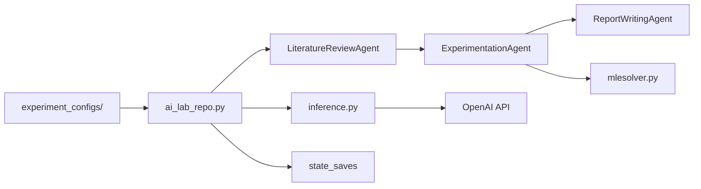

# SamuelSchmidgall/AgentLaboratory

> Chain of LLM agents that carries out research: literature review, experiments, LaTeX writing.

## The problem
Reviewing papers, preparing data, writing experiment code and drafting a report take most of a researcher's time.

## What it actually does
Three phases orchestrated by `ai_lab_repo.py` from a YAML config: literature (arXiv), experimentation (Python, Hugging Face), report (LaTeX).
Specialized agents per step, `mlesolver.py` and `papersolver.py` solvers.
Checkpoints in `state_saves` to resume; copilot mode with a human in the loop.
Compatible with AgentRxiv, where agents share their work.

## How it is wired


## Trying it
```bash
git clone git@github.com:SamuelSchmidgall/AgentLaboratory.git
python -m venv venv_agent_lab
source venv_agent_lab/bin/activate
pip install -r requirements.txt
python ai_lab_repo.py --yaml-location "experiment_configs/MATH_agentlab.yaml"
```

## Cost and gotchas
LLM bill at your expense, which climbs with the recommended models (o1); pdflatex optional.

## What it is not
Not a reliable autonomous researcher: the README speaks of a codebase with "a lot of room for improvement". The generated code runs locally.

## Alternatives
No alternative named in the README.

## For you
Worth watching: interesting for prototyping automated ML baselines, but research code frozen for over a year, to be confined to experimentation.
