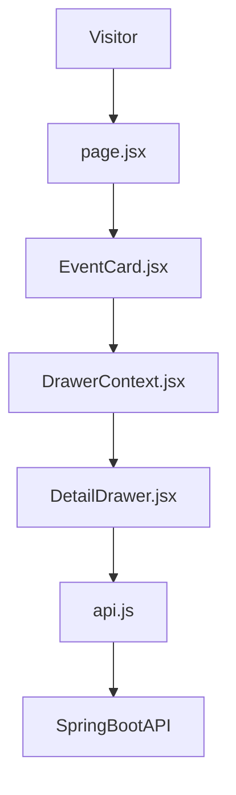

# SandeepVashishtha/Eventra

> Next.js 16 frontend for discovering events, hackathons and open source projects, connected to a Spring Boot API on Azure.

## The problem
Tech communities have no single portal to find workshops, hackathons and projects to support.

## What it actually does
- Lists and detail pages for events, hackathons, projects; detail drawer via `DrawerContext.jsx`.
- Registration, voting for a project, user dashboard, organizer analytics.
- JWT authentication stored in localStorage (`eventra_token`).
- Everything goes through `src/lib/api.js` to a hosted backend that the repository does not contain.

## How it is wired


## Trying it
```bash
cd Eventra
npm install
npm run dev
# http://localhost:3000
npm run build
npm run start
```

## Cost and gotchas
Free for the frontend, Node 18+ required. Without the README's Azure backend (public URL hard-coded), the application has no data. 2,050 open issues.

## What it is not
Not a complete platform: only the web client. No license declared, so reuse is not permitted by default.

## Alternatives
None named in the README.

## For you
Ignore: a simple frontend dependent on a third-party backend, with no license and unrelated to data / AI / MLOps.
