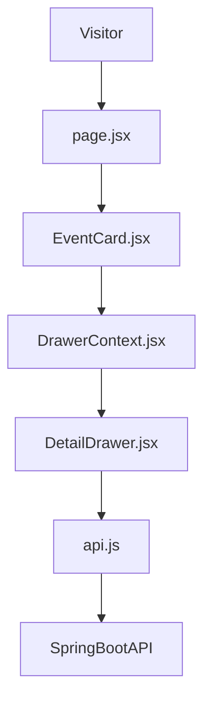

# SandeepVashishtha/Eventra

> Frontend Next.js 16 pour découvrir événements, hackathons et projets open source, relié à une API Spring Boot sur Azure.

## Le problème
Les communautés techniques n'ont pas de portail unique pour trouver ateliers, hackathons et projets à soutenir.

## Ce que ça fait vraiment
- Listes et pages détaillées pour événements, hackathons, projets ; tiroir de détail via `DrawerContext.jsx`.
- Inscription, vote pour un projet, tableau de bord utilisateur, analytique organisateur.
- Authentification par JWT stocké en localStorage (`eventra_token`).
- Tout passe par `src/lib/api.js` vers un backend hébergé que le dépôt ne contient pas.

## Comment c'est branché


## Essayer
```bash
cd Eventra
npm install
npm run dev
# http://localhost:3000
npm run build
npm run start
```

## Coût et pièges
Gratuit pour le frontend, Node 18+ requis. Sans le backend Azure du README (URL publique codée), l'application n'a pas de données. 2 050 issues ouvertes.

## Ce que ce n'est pas
Pas une plateforme complète : seulement le client web. Aucune licence déclarée, donc réutilisation non autorisée par défaut.

## Alternatives
Aucune nommée dans le README.

## Pour toi
À ignorer : simple frontend dépendant d'un backend tiers, sans licence et sans rapport avec data / IA / MLOps.

