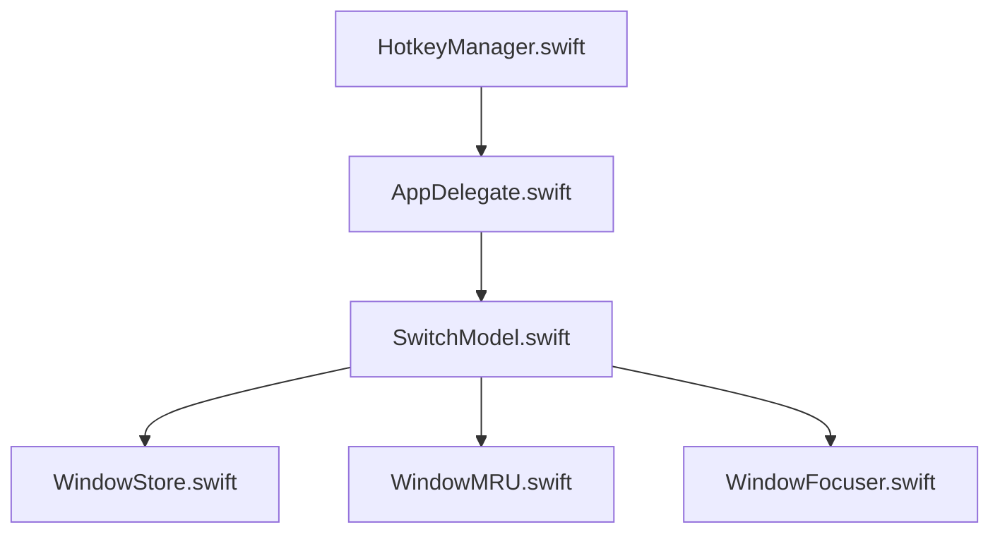

# Sanyam-G/switch

> Keyboard-driven macOS window switcher, with thumbnails and built-in search.

## The problem
Cmd-Tab switches between applications, not windows, and does not show the windows of other Spaces.

## What it actually does
Cmd-Tab cycles through all windows, Option-` through those of the current application. You filter by typing and pick with 1 to 9. Windows from other Spaces appear with a badge and are brought into the current Space. Vertical list modes, excluded applications, "sticky" mode.

## How it is wired


## Trying it
```bash
brew install --cask Sanyam-G/switch/switch
brew uninstall --cask Sanyam-G/switch/switch
```

## Cost and gotchas
Free, signed and notarized by Apple, macOS 14 minimum. License present but not identified by GitHub: check before any use beyond personal.

## What it is not
Not a window-tiling manager nor a cross-platform tool: macOS only.

## Alternatives
No alternative named in the README.

## For you
Ignore: a macOS comfort utility, unrelated to data / AI / MLOps work, and useless under WSL.
