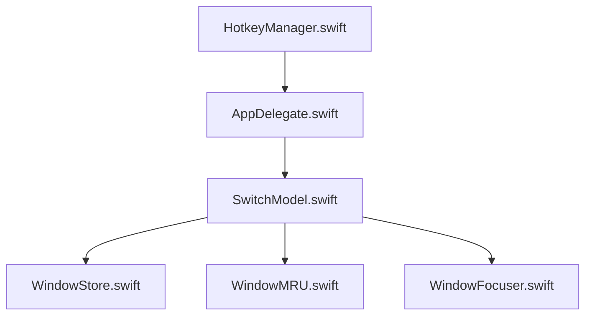

# Sanyam-G/switch

> Sélecteur de fenêtres macOS piloté au clavier, avec miniatures et recherche intégrée.

## Le problème
Cmd-Tab bascule entre applications, pas entre fenêtres, et ne montre pas les fenêtres des autres Spaces.

## Ce que ça fait vraiment
Cmd-Tab fait défiler toutes les fenêtres, Option-` celles de l'application courante. On filtre en tapant, on choisit avec 1 à 9. Les fenêtres d'autres Spaces apparaissent avec un badge et viennent dans le Space courant. Modes liste verticale, applications exclues, mode « sticky ».

## Comment c'est branché


## Essayer
```bash
brew install --cask Sanyam-G/switch/switch
brew uninstall --cask Sanyam-G/switch/switch
```

## Coût et pièges
Gratuit, signé et notarisé par Apple, macOS 14 minimum. Licence présente mais non identifiée par GitHub : à vérifier avant tout usage hors personnel.

## Ce que ce n'est pas
Pas un gestionnaire de placement de fenêtres ni un outil multiplateforme : macOS uniquement.

## Alternatives
Aucune alternative nommée dans le README.

## Pour toi
Ignorer : utilitaire macOS de confort, sans lien avec un travail data / IA / MLOps, et inutile sous WSL.

