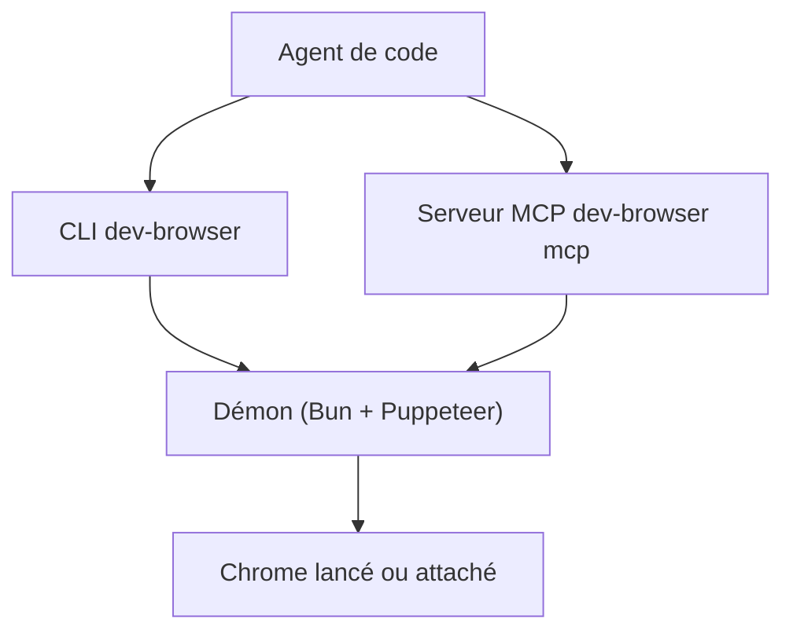

# SawyerHood/dev-browser

> CLI that lets a coding agent drive Chrome through short persistent JavaScript scripts.

## The problem
An agent automating a browser has to start over on every call: page reopened, state lost, unreadable outputs.

## What it actually does
A daemon keeps Chrome open between scripts. Named pages keep their state, accessibility snapshots give stable references, and the API is Puppeteer's plus a few helpers. You launch an isolated profile or connect to an existing Chrome. An MCP server is also provided.

## How it is wired
Simplified diagram based on the fiche, no diagram provided.



## Trying it
```bash
npm install -g dev-browser
dev-browser install
dev-browser --headless <<'EOF'
const page = await browser.getPage("main");
await page.goto("https://example.com");
console.log(await page.title());
EOF
```

## Cost and gotchas
Free. macOS and Linux glibc only. The `node:vm` sandbox is not a security boundary: only allow `dev-browser *` without confirmation on trusted scripts. Profiles and cookies stay on disk.

## What it is not
Not a testing framework or a browser: it drives Chrome. No Windows or musl support for now.

## Alternatives
- Puppeteer: the API it builds on, without the daemon or the agent helpers.

## For you
Worth watching: useful if your agents need to browse the web, but the project has a single author and version 1.0 is recent.
