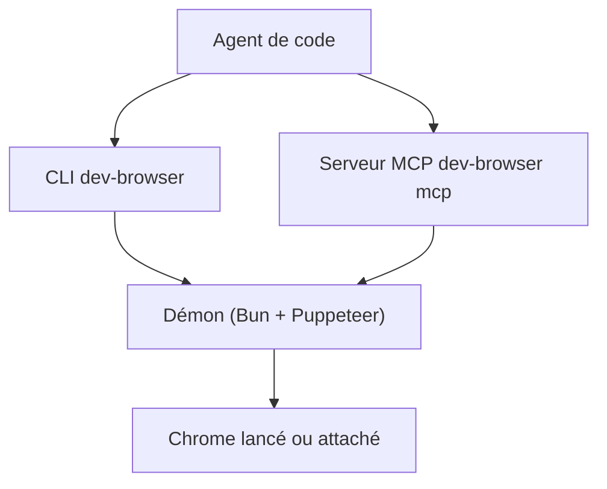

# SawyerHood/dev-browser

> CLI qui laisse un agent de code piloter Chrome par de courts scripts JavaScript persistants.

## Le problème
Un agent qui automatise un navigateur doit tout recommencer à chaque appel : page rouverte, état perdu, sorties illisibles.

## Ce que ça fait vraiment
Un démon garde Chrome ouvert entre les scripts. Les pages nommées conservent leur état, les snapshots d'accessibilité donnent des références stables, et l'API est celle de Puppeteer plus quelques aides. On lance un profil isolé ou on se connecte à un Chrome existant. Un serveur MCP est aussi fourni.

## Comment c'est branché
Schéma simplifié d'après la fiche, sans diagramme fourni.



## Essayer
```bash
npm install -g dev-browser
dev-browser install
dev-browser --headless <<'EOF'
const page = await browser.getPage("main");
await page.goto("https://example.com");
console.log(await page.title());
EOF
```

## Coût et pièges
Gratuit. macOS et Linux glibc seulement. Le bac à sable `node:vm` n'est pas une frontière de sécurité : n'autorise `dev-browser *` sans confirmation que sur des scripts de confiance. Les profils et cookies restent sur le disque.

## Ce que ce n'est pas
Pas un framework de test ni un navigateur : il pilote Chrome. Pas de support Windows ni musl pour l'instant.

## Alternatives
- Puppeteer : l'API sur laquelle il s'appuie, sans le démon ni les aides pour agents.

## Pour toi
À surveiller : utile si tes agents doivent naviguer sur le web, mais le projet a un seul auteur et la version 1.0 est récente.

