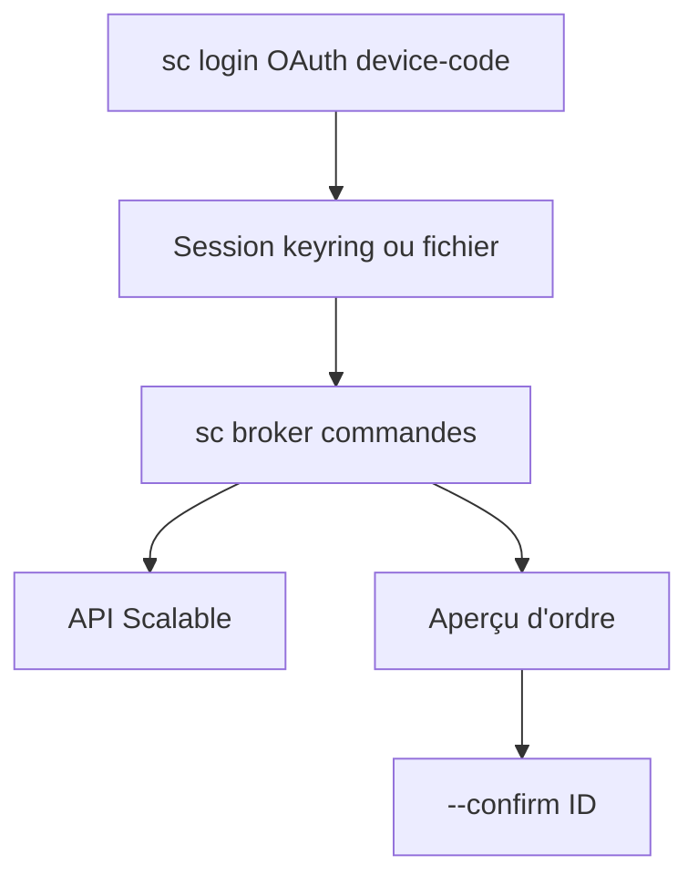

# ScalableCapital/scalable-cli

> Official command line for managing your Scalable Broker account, usable by scripts and AI agents.

## The problem
Automating an online broker means browser scraping or Selenium, which is fragile and unsupported.

## What it actually does
`sc` queries the Scalable API: portfolios, holdings, transactions, quotes, savings plans. Orders follow two steps (preview, then confirmation by an ID valid for 15 minutes). The `--json` output is meant for scripts. A local read-only mode blocks writes.

## How it is wired
Simplified diagram based on the note, no diagram provided.



## Trying it
```bash
brew tap ScalableCapital/tap
brew trust --formula ScalableCapital/tap/scalable-cli
brew install scalable-cli
sc login
sc whoami
sc broker overview --json
```

## Cost and gotchas
You need a Scalable Broker account and must enable "Agentic Investing" in your profile. Linux binaries: glibc 2.38 minimum, no musl. JSON compatibility is not guaranteed between versions.

## What it is not
It is not an autonomous trading tool: the login must be done by a human and order confirmation requires a separate client response. No portfolio analytics in this version.

## Alternatives
No alternative named in the README.

## For you
Worth watching: useful only if you are a Scalable customer, but the two-step confirmation scheme is a good model for agents that handle money.
