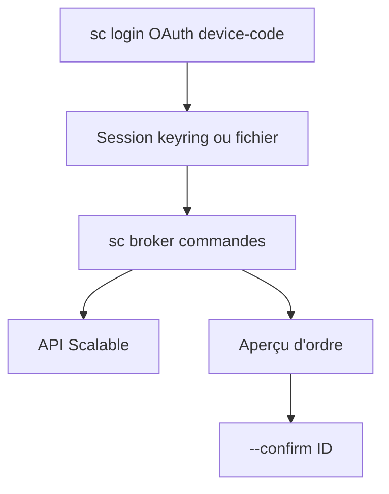

# ScalableCapital/scalable-cli

> Ligne de commande officielle pour piloter son compte Scalable Broker, utilisable par scripts et agents IA.

## Le problème
Automatiser un courtier en ligne passe par du scraping de navigateur ou Selenium, fragile et non supporté.

## Ce que ça fait vraiment
`sc` interroge l'API Scalable : portefeuilles, avoirs, transactions, cotations, plans d'épargne. Les ordres suivent deux étapes (aperçu puis confirmation par ID valable 15 minutes). La sortie `--json` sert aux scripts. Un mode lecture seule local bloque les écritures.

## Comment c'est branché
Schéma simplifié d'après la fiche, sans diagramme fourni.



## Essayer
```bash
brew tap ScalableCapital/tap
brew trust --formula ScalableCapital/tap/scalable-cli
brew install scalable-cli
sc login
sc whoami
sc broker overview --json
```

## Coût et pièges
Il faut un compte Scalable Broker et activer « Agentic Investing » dans le profil. Binaires Linux : glibc 2.38 minimum, pas de musl. Compatibilité du JSON non garantie entre versions.

## Ce que ce n'est pas
Ce n'est pas un outil de trading autonome : la connexion doit être faite par un humain et la confirmation d'ordre exige une réponse client distincte. Pas d'analytique de portefeuille dans cette version.

## Alternatives
Aucune alternative nommée dans le README.

## Pour toi
À surveiller : utile seulement si tu es client Scalable, mais le schéma de confirmation en deux temps est un bon modèle pour des agents qui touchent à l'argent.

