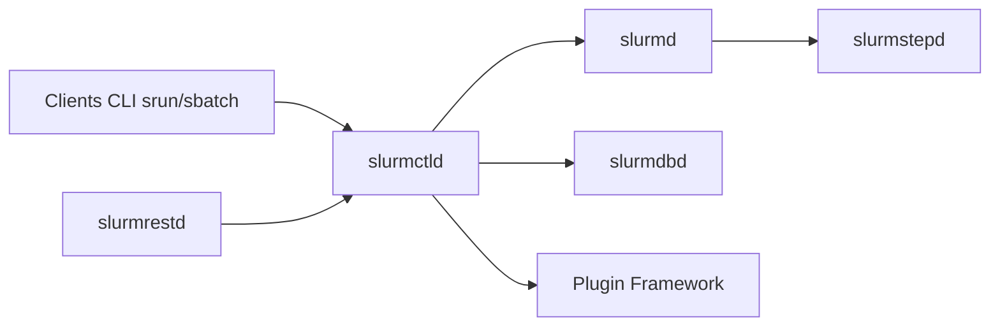

# SchedMD/slurm

> Resource manager and job scheduler for Linux HPC clusters.

## The problem
Share compute nodes between users: allocate, launch, monitor and queue jobs.

## What it actually does
Allocates nodes with exclusive or shared access, provides the framework to launch and supervise parallel jobs, and arbitrates a queue. From the code: `slurmctld` (controller), `slurmd`/`slurmstepd` (nodes), `slurmdbd` (SQL accounting), `slurmrestd` (REST API), CLI clients (srun, sbatch…), C API, plugin framework (auth, scheduling, job_submit…).

## How it is wired

## Trying it
No command documented in the README: see INSTALL and the site documentation.

## Cost and gotchas
Free; autotools build; tested on Linux only. GPL license (COPYING, LICENSE.OpenSSL) but not recognized by GitHub.

## What it is not
Not a container orchestrator like Kubernetes: HPC-oriented.

## Alternatives
No alternative named in the README.

## For you
Worth watching: essential if you train on a shared HPC cluster; useless on a workstation or in a managed cloud.
