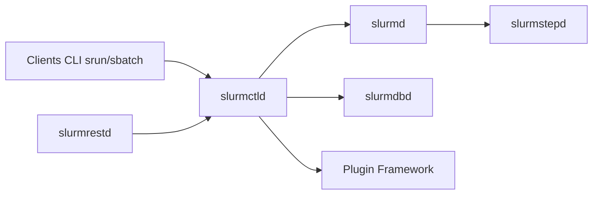

# SchedMD/slurm

> Gestionnaire de ressources et ordonnanceur de jobs pour clusters HPC sous Linux.

## Le problème
Partager des nœuds de calcul entre utilisateurs : allouer, lancer, surveiller et mettre en file les jobs.

## Ce que ça fait vraiment
Alloue des nœuds en accès exclusif ou partagé, fournit le cadre pour lancer et superviser des jobs parallèles, arbitre une file d'attente. D'après le code : `slurmctld` (contrôleur), `slurmd`/`slurmstepd` (nœuds), `slurmdbd` (comptabilité SQL), `slurmrestd` (API REST), clients CLI (srun, sbatch…), API C, framework de plugins (auth, ordonnancement, job_submit…).

## Comment c'est branché

## Essayer
Aucune commande documentée dans le README : voir INSTALL et la documentation du site.

## Coût et pièges
Gratuit ; compilation autotools ; testé sous Linux uniquement. Licence GPL (COPYING, LICENSE.OpenSSL) mais non reconnue par GitHub.

## Ce que ce n'est pas
Pas un orchestrateur de conteneurs type Kubernetes : orienté HPC.

## Alternatives
Aucune alternative nommée dans le README.

## Pour toi
À surveiller : incontournable si tu entraînes sur un cluster HPC partagé ; inutile sur un poste ou en cloud managé.

