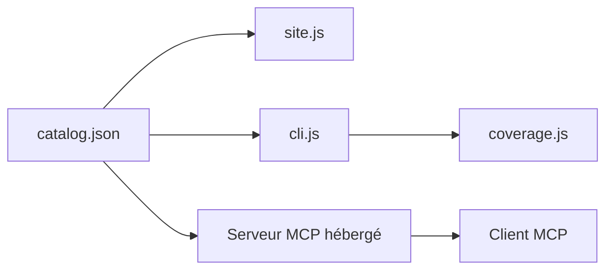

# SchemaStore/schemastore

> A community catalog of JSON schemas for common config files, with a hosted MCP server.

## The problem
Validating or completing a config file (package.json, CI workflows…) requires finding the right JSON Schema.

## What it actually does
A repository of schemas indexed in `catalog.json`, a site to browse them, a CLI to validate the schemas and measure coverage. A public MCP server (mcp.schemastore.org) lets an assistant search and fetch schemas; its code is not in this repository.

## How it is wired


## Trying it
```json
{
  "servers": {
    "SchemaStore": {
      "url": "https://mcp.schemastore.org/",
      "type": "http"
    }
  }
}
```
To be placed in `.vscode/mcp.json`.

## Cost and gotchas
Free, funded by donations; companies are invited to sponsor. The MCP server is a hosted third-party service.

## What it is not
Not a ready-to-use validator: it is the collection of schemas. The MCP is not self-hostable according to this README.

## Alternatives
None cited in the README.

## For you
A reliable source of schemas to validate configs and pipelines: adopt, especially since the editor already consumes it.
