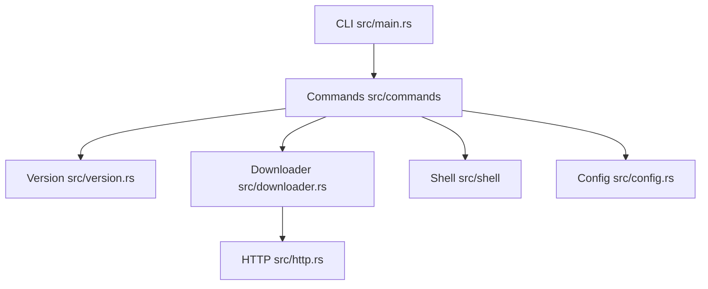

# Schniz/fnm

> Node.js version manager written in Rust, fast and cross-platform, for JavaScript developers.

## The problem
Every project demands its own Node.js version, and switching by hand is slow and error-prone.

## What it actually does
A single binary that installs and selects Node.js versions, reads `.node-version` and `.nvmrc` files, and switches automatically when the directory changes (`--use-on-cd`). It integrates with bash, zsh, fish, PowerShell and cmd by evaluating `fnm env`. It also provides completions.

## How it is wired



## Trying it
```bash
curl -fsSL https://fnm.vercel.app/install | bash
brew install fnm
eval "$(fnm env --use-on-cd --shell bash)"
node --version > .node-version
```

## Cost and gotchas
Free. The install script requires curl and unzip. You must add the `fnm env` line to your shell profile, otherwise nothing changes. On macOS, the script is deprecated in favor of Homebrew. Gotcha: a `curl | bash` runs without review.

## What it is not
It is not a package manager (npm, pnpm) nor a Python version manager. Cmd.exe is not fully covered according to the README.

## Alternatives
No alternative named in the README.

## For you
Adopt if your AI or front-end tools run on Node: a fast manager, useful at little cost; of no interest if you never touch JavaScript.
