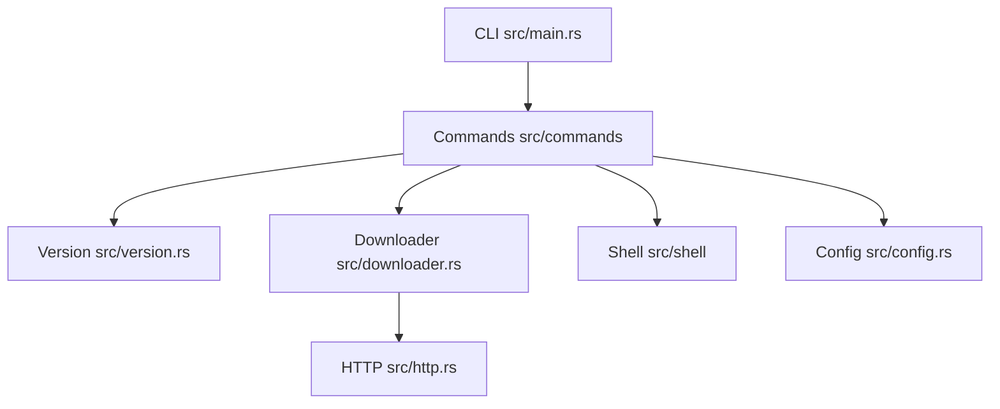

# Schniz/fnm

> Gestionnaire de versions de Node.js en Rust, rapide et multiplateforme, pour développeurs JavaScript.

## Le problème
Chaque projet exige sa version de Node.js, et en changer à la main est lent et sujet aux erreurs.

## Ce que ça fait vraiment
Binaire unique qui installe et sélectionne des versions de Node.js, lit les fichiers `.node-version` et `.nvmrc`, et bascule automatiquement au changement de répertoire (`--use-on-cd`). Il s'intègre à bash, zsh, fish, PowerShell et cmd par l'évaluation de `fnm env`. Il fournit aussi des complétions.

## Comment c'est branché



## Essayer
```bash
curl -fsSL https://fnm.vercel.app/install | bash
brew install fnm
eval "$(fnm env --use-on-cd --shell bash)"
node --version > .node-version
```

## Coût et pièges
Gratuit. Le script d'installation exige curl et unzip. Il faut ajouter la ligne `fnm env` au profil de ton shell, sinon rien ne change. Sous macOS, le script est déprécié au profit de Homebrew. Piège : un `curl | bash` s'exécute sans relecture.

## Ce que ce n'est pas
Ce n'est pas un gestionnaire de paquets (npm, pnpm) ni de versions Python. Cmd.exe n'est pas entièrement couvert d'après le README.

## Alternatives
Aucune alternative nommée dans le README.

## Pour toi
À adopter si tes outils d'IA ou de front tournent sur Node : un gestionnaire rapide, utile à peu de frais ; sans intérêt si tu ne touches jamais à JavaScript.

