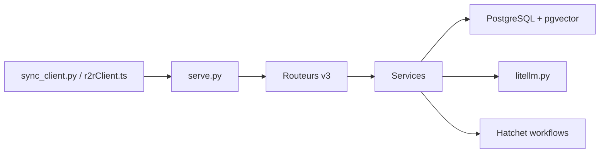

# SciPhi-AI/R2R

> Self-hostable RAG platform exposed as a REST API (minimal sheet: empty root README).

## The problem
Unusable README: it contains only the link `./py/README.md`. Judging by the architecture, R2R spares you from building ingestion, hybrid search and RAG agents yourself.

## What it actually does
Judging by the code: Python server (`serve.py`) with v3 routers (documents, retrieval, graphs…).
Ingestion with parsers, chunking, embeddings, then storage in PostgreSQL + pgvector.
RAG agents and search, web search tools, knowledge graph through Hatchet workflows.
Python and TypeScript SDKs.

## How it is wired

## Trying it
No command documented in the root README.

## Cost and gotchas
LLM and embedding keys are at your expense (OpenAI, LiteLLM…). The full mode requires Postgres, Hatchet, RabbitMQ and MinIO.

## What it is not
Not documented in the root README: the sheet relies solely on the architecture inferred from the code.

## Alternatives
No alternative named in the README.

## For you
Worth watching: the RAG architecture is complete and relevant to you, but you need to read `py/README.md` before judging, since the root README says nothing.
