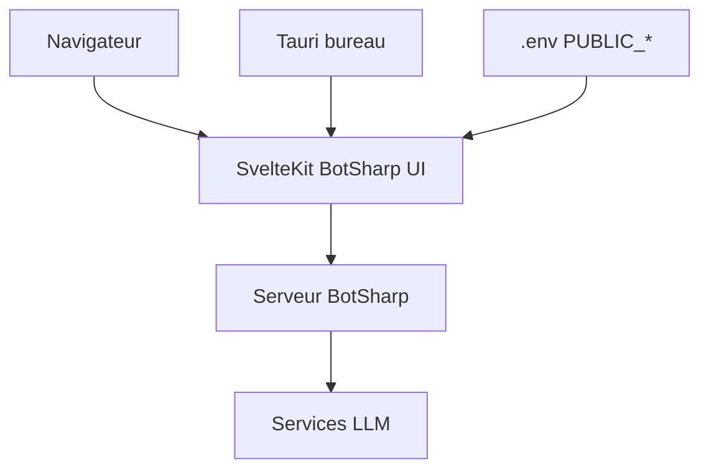

# SciSharp/BotSharp-UI

> Web interface for managing AI agents and their conversations on the BotSharp server.

## The problem
Building and administering agents and their conversations without an interface forces you to go through the API.

## What it actually does
SvelteKit 2 application that creates and manages agents, with a node-based editor, and browses conversations. It relies on BotSharp for language model services. It also exists as a Tauri desktop application that exposes no native commands. A build script checks that prefilled credentials do not end up in the distributed package.

## How it is wired
Simplified diagram based on the sheet, no diagram provided.



## Trying it
```bash
git clone https://github.com/SciSharp/BotSharp-UI
cd BotSharp-UI
npm install
npm run dev
```

## Cost and gotchas
Free, but you need a running BotSharp server. The versioned `.env` contains test administrator credentials: use only `build:verified` for a deployment.

## What it is not
Not an agent engine: it is only the BotSharp interface. The Tauri desktop app requires Rust to be compiled.

## Alternatives
No alternative named in the README.

## For you
Worth watching: useful if you adopt BotSharp (.NET ecosystem) for your agents; without it, the interface has no value.
