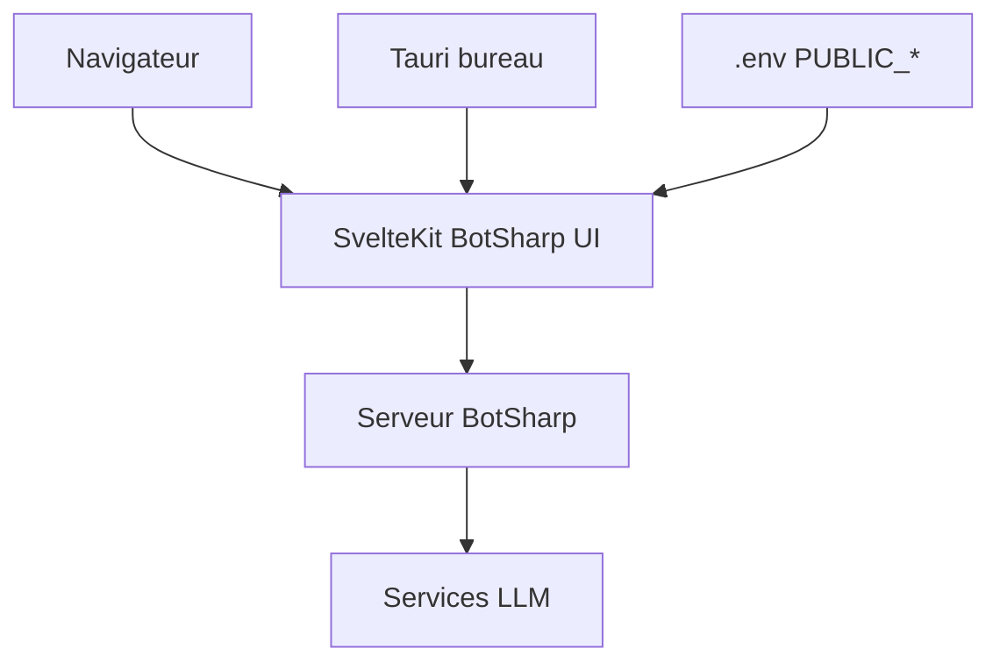

# SciSharp/BotSharp-UI

> Interface web pour gérer des agents IA et leurs conversations sur le serveur BotSharp.

## Le problème
Construire et administrer des agents et leurs conversations sans interface oblige à passer par l'API.

## Ce que ça fait vraiment
Application SvelteKit 2 qui crée et gère des agents, avec un éditeur par nœuds, et consulte les conversations. Elle s'appuie sur BotSharp pour les services de modèles de langage. Elle existe aussi en application de bureau Tauri qui n'expose aucune commande native. Un script de build vérifie que les identifiants de prérempli ne se retrouvent pas dans le paquet distribué.

## Comment c'est branché
Schéma simplifié d'après la fiche, sans diagramme fourni.



## Essayer
```bash
git clone https://github.com/SciSharp/BotSharp-UI
cd BotSharp-UI
npm install
npm run dev
```

## Coût et pièges
Gratuit, mais il faut un serveur BotSharp en marche. Le `.env` versionné contient des identifiants d'administrateur de test : n'utilise que `build:verified` pour un déploiement.

## Ce que ce n'est pas
Pas un moteur d'agents : c'est seulement l'interface de BotSharp. Le bureau Tauri demande Rust pour être compilé.

## Alternatives
Aucune alternative nommée dans le README.

## Pour toi
À surveiller : utile si tu adoptes BotSharp (écosystème .NET) pour tes agents ; sans lui, l'interface n'a pas d'intérêt.

