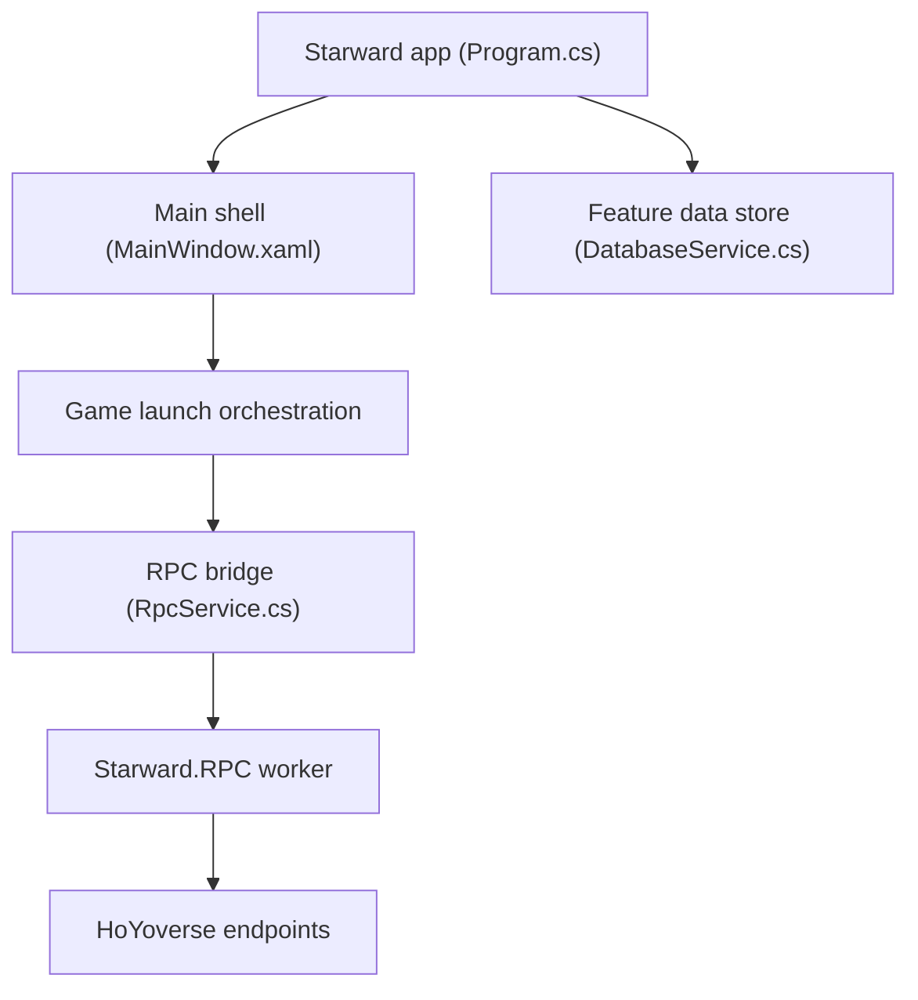

# Scighost/Starward

> Free Windows launcher for HoYoverse games, replacing the official HoYoPlay launcher.

## The problem
miHoYo's official launcher is considered limited: no playtime tracking, no account switching, no archiving of pulls.

## What it actually does
Windows desktop application that installs, updates and launches HoYoverse games, tracks playtime, switches accounts, displays screenshots and records pull history (gacha). A local RPC process handles package downloads.

## How it is wired
Diagram based on the one provided.

## Trying it
No documented command. Download the suitable package from GitHub Release, extract it, then run `Starward.exe` and follow the instructions.

## Cost and gotchas
Free. Windows 10 1809 minimum, WebView2 and the WebP image extension required. It depends on HoYoverse services: a change on the publisher's side can break features.

## What it is not
Not an official tool, nor for any system other than Windows. Nothing to do with data or AI.

## Alternatives
No alternative named in the README (the official HoYoPlay launcher is the reference it replaces).

## For you
Ignore: a Windows game launcher unrelated to data, AI or MLOps.
