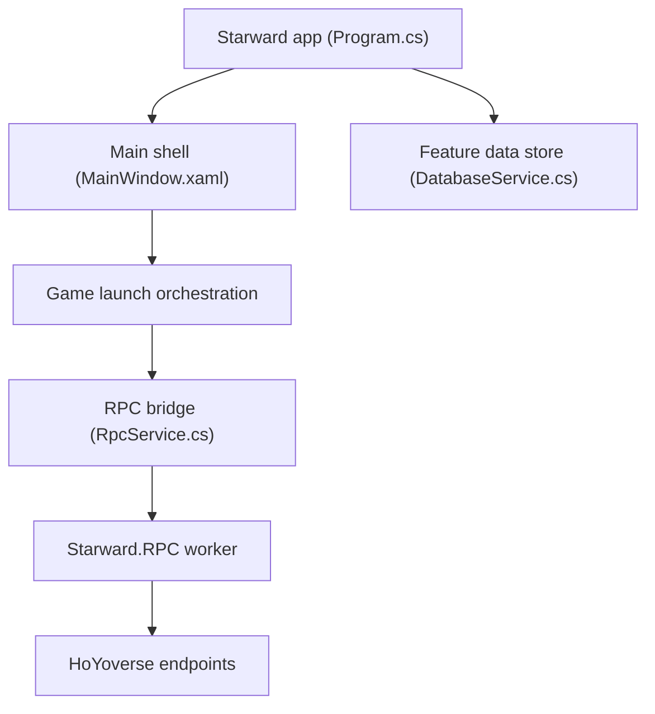

# Scighost/Starward

> Lanceur Windows libre pour les jeux HoYoverse, qui remplace le lanceur officiel HoYoPlay.

## Le problème
Le lanceur officiel de miHoYo est jugé limité : pas de suivi du temps de jeu, de changement de compte ni d'archivage des tirages.

## Ce que ça fait vraiment
Application de bureau Windows qui installe, met à jour et lance les jeux HoYoverse, suit le temps de jeu, change de compte, affiche les captures d'écran et enregistre l'historique des tirages (gacha). Un processus RPC local gère les téléchargements de paquets.

## Comment c'est branché
Schéma d'après le diagramme fourni.

## Essayer
Aucune commande documentée. Télécharger le paquet adapté depuis GitHub Release, l'extraire, puis lancer `Starward.exe` et suivre les indications.

## Coût et pièges
Gratuit. Windows 10 1809 minimum, WebView2 et l'extension d'images WebP requis. Il dépend des services de HoYoverse : un changement côté éditeur peut casser des fonctions.

## Ce que ce n'est pas
Pas un outil officiel ni pour un autre système que Windows. Aucun rapport avec la data ou l'IA.

## Alternatives
Aucune alternative nommée dans le README (le lanceur officiel HoYoPlay est la référence remplacée).

## Pour toi
À ignorer : lanceur de jeux Windows sans lien avec la data, l'IA ou le MLOps.

