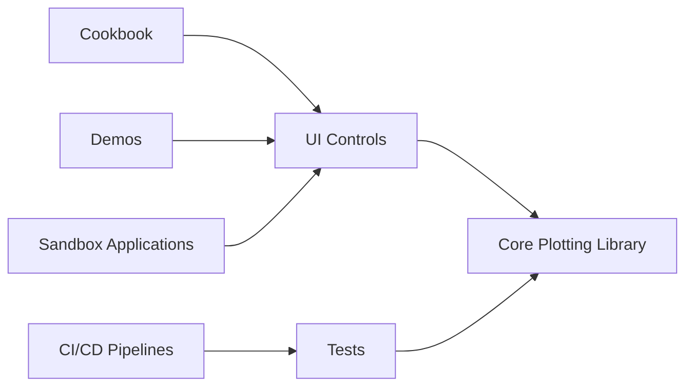

# ScottPlot/ScottPlot

> Free .NET library for plotting interactive charts of large datasets.

## The problem
Quickly plotting lines, bars and scatter plots in a .NET application usually requires heavy or paid components.

## What it actually does
A plotting library with a UI-independent core and controls for Windows Forms, WPF, Blazor, Avalonia, Eto, Uno, MAUI and WinUI. A cookbook shows each chart type in a few lines, and demos illustrate the interactivity. The repository also contains tests, sandbox applications and development tools.

## How it is wired

## Trying it
No command in the README: documentation and recipes are on ScottPlot.NET.

## Cost and gotchas
Free, MIT. The README states that the project does not accept anonymous code contributions, because of the author's health: the continuity risk rests on one person.

## What it is not
Not a Python library and not a dashboard tool. It targets the .NET world.

## Alternatives
No alternative named in the README.

## For you
Ignore if you work in Python: only useful for .NET applications that need to display charts.
