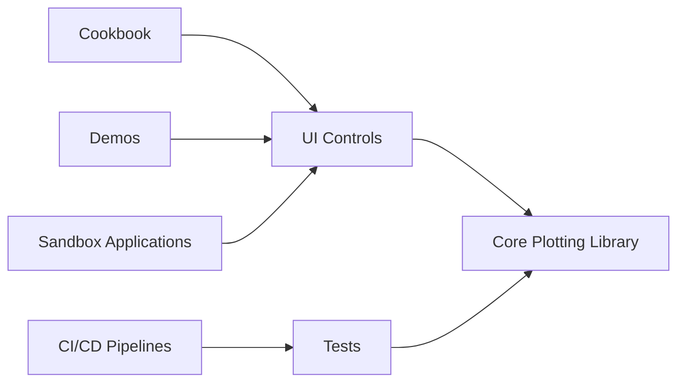

# ScottPlot/ScottPlot

> Bibliothèque .NET gratuite pour tracer des graphiques interactifs de grands jeux de données.

## Le problème
Tracer rapidement courbes, barres et nuages de points dans une application .NET demande habituellement des composants lourds ou payants.

## Ce que ça fait vraiment
Bibliothèque de tracé avec un cœur indépendant de l'interface et des contrôles pour Windows Forms, WPF, Blazor, Avalonia, Eto, Uno, MAUI et WinUI. Un livre de recettes montre chaque type de graphique en quelques lignes, et des démonstrations illustrent l'interactivité. Le dépôt contient aussi tests, applications bac à sable et outils de développement.

## Comment c'est branché

## Essayer
Aucune commande dans le README : documentation et recettes sont sur ScottPlot.NET.

## Coût et pièges
Gratuit, MIT. Le README précise que le projet n'accepte pas de contributions de code anonymes, à cause de l'état de santé de son auteur : le risque de continuité repose sur une personne.

## Ce que ce n'est pas
Pas une bibliothèque Python ni un outil de tableaux de bord. Elle s'adresse au monde .NET.

## Alternatives
Aucune alternative nommée dans le README.

## Pour toi
À ignorer si tu travailles en Python : utile seulement pour des applications .NET qui doivent afficher des graphiques.

